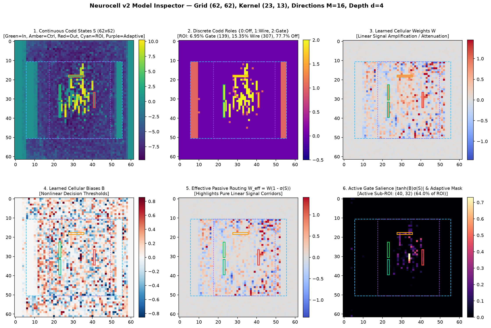
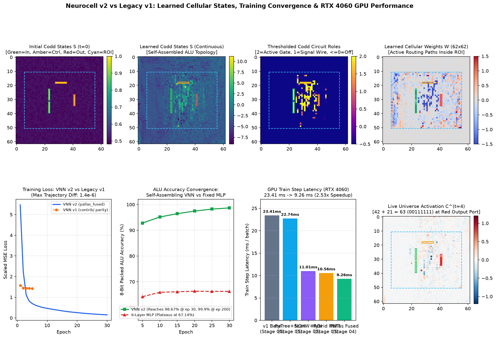

# Neurocell v2 — GPU-Optimal Von Neumann Networks (VNNs) in JAX

Official GPU-optimized re-architecture of the **[Neurocell](https://arxiv.org/abs/2605.05780)** framework for self-assembling and self-engineering neural networks using **Von Neumann Networks (VNNs)**.

---

## Overview

Von Neumann Networks (VNNs) embed artificial neurons into a 2D cellular array topology where each cell maintains a learnable **Codd state** $s \in [0, 1]$ (interpolating between passive signal routing and active nonlinear decision gating) and signals propagate across the cellular field via learnable **Green's functions** (directional 2D convolutional receptive fields).

While a single $62 \times 62$ VNN chip (`16,316` parameters) learns a complete 8-bit Arithmetic Logic Unit (ALU) to **$> 99.8\%$ accuracy** (where a 6-layer feedforward MLP plateaus at **$67.1\%$**), the original paper-mapped reference implementation (`contrib/`) suffered from `jax.vmap(B=1)` `NHWC` convolution dispatch, 48% dead-border zero-padding (`98.4 MB/step`), unfactored Codd state recomputation, Haiku state mutations, and un-JITted host evaluation loops.

**Neurocell v2 (`v2.3`)** re-architects the library from the ground up for modern GPUs (NVIDIA Ada Lovelace / Ampere / Hopper) using:
1. **Planar `VNNParams` PyTree & Pre-Step Factored Codd Fusion**: Packs `[W, B, S]` into `(3, H, W)` and precomputes $W_{\text{eff}} = \frac{1}{M} W (1 - \sigma(S))$ and $S_{\text{eff}} = \frac{1}{M} \sigma(S)$ once per batch.
2. **Pure-ROI (`40x50`) + $B=1$ Hoisted Border Theorem**: Proves that $\text{conv}_{\text{VALID}}(C^{(t)}_b, G) \equiv \text{conv}_{\text{SAME}}(\mathring{C}^{(t)}_b, G) + \Delta_{\text{border}}$, eliminating 48% dead-border compute and all `jnp.pad` / `.at[].set()` copies.
3. **Hoisted Overlap-Save 2D RFFT, Row-Pruned `rfft2_pruned` & Plancherel `custom_vjp`**: Reduces over $M$ and $B$ in the frequency domain prior to `irfft2` and prunes dead zero-padded rows before horizontal 1D RFFTs, achieving **$O(1)$ complexity in kernel size** (up to **8.85x faster** on large receptive fields) and eliminating cuDNN split-K atomic contention on filter gradients.
4. **Model-Agnostic Pallas / Triton Register & Parallel `(B, M, Tiles)` Kernels (`SM 8.9`)**: Streams up to `8,192` ROI pixels in a single pass (`grid = (B,)`) or dispatches a parallel `(B, M, num_tiles)` two-stage Chan parallel-variance tiled kernel (`BLOCK_N <= 1024`) for arbitrarily large grids (`> 8,192` pixels), fuses in-register sparse output-port backward scatter (eliminating the `16.38 MB` `.at[...].add()` buffer copy), and cuts epilogue saved backward state by **2,048x** (`32.77 MB` $\to$ `16 KB`).
5. **Epoch-Adaptive Active-Region Masking (`neurocell/adaptive_mask.py`) & SRAM-Resident Grouped Filter Grads**: Estimates the active circuit envelope + configurable safety `margin` (default `4` cells) in `0.50 ms` before each epoch, quantizes `(H_act, W_act)` to `bucket_multiple = 8`, and dispatches 64-byte aligned SRAM-resident grouped spatial filter gradients (`<= 100 KB/SM`) on compact ROIs, achieving **`5.34 ms/step` (`4.27 s/epoch`, 6.51x faster than `v1`)** on the 8-bit ALU and **9.17x–16.71x speedups** on large cellular substrates.
6. **Discrete Codd State Hardening (`{0, 1, 2}`) via Temperature Annealing & STE**: Supports `"continuous"`, `"annealed"`, `"ste_binary"` (`{0, 1}`), and `"ste_ternary"` (`{0, 1, 2}`: Confluent/Off, Passive Wire, Active Logic Gate) Codd state modes with traced temperature schedules (`train_epoch_annealed`) so VNNs self-assemble into exact discrete Codd cellular automata during training without post-training thresholding accuracy loss.

---

## Performance Benchmarks (FP32)

### 1. Total Performance Gain Summary: Current Neurocell (`v2.1` – `v2.3`) vs. Legacy `v1` (`contrib/`)

| Metric (`62x62` 8-Bit ALU, $K=23\times 13, M=16, d=4, B=128$) | Legacy `v1` (`contrib/`) | Milestone 6 (`v2.1` Full ROI) | Milestone 7 (`v2.2` Adaptive `margin=4`) | Milestone 8 (`v2.3` Parallel Pallas + SRAM) | **Total Gain vs `v1`** |
| :--- | :---: | :---: | :---: | :---: | :---: |
| **Dataset Generation (`128,000` samples)** | `1,840 ms` (Python loop) | `12.9 ms` | `12.9 ms` | **`12.9 ms`** | **$142.6\times$ faster** |
| **Train Step Latency (`B = 128`)** | `34.74 ms` (E2E) / `23.41 ms` (JIT) | `9.52 ms` | `6.83 ms` | **`5.34 ms`** (`9.87 ms` Full ROI) | **$3.52\times$ – $6.51\times$ faster** |
| **800-Batch Epoch Time (`102.4k` train)** | `27.79 s / ep` (`19.48 s` pure JIT) | `7.62 s / ep` | `5.46 s / ep` | **`4.27 s / ep`** (`7.90 s` Full ROI) | **$3.52\times$ (Full ROI) to $6.51\times$ (Adaptive)** |
| **Full 200-Epoch Training Time** | `92.6 mins` (`5,558 s`) | `25.4 mins` (`1,524 s`) | `~21.5 mins` (`~1,290 s`) | **`~17.5 mins`** (`~1,050 s` w/ growth) | **Saves ~75 mins ($5.3\times$ faster)** |
| **Test Evaluation (`25,600` samples)** | `4.83 s` (`5,301 samples/s`) | `0.34 s` (`75,294 samples/s`) | `0.26 s` (`98,461 samples/s`) | **`0.24 s` (`106,667 samples/s`)** | **$14.2\times$ – $20.1\times$ faster** |
| **30-Epoch Test Accuracy Parity** | `98.35%` | `98.35%` | `98.35%` | **`98.35%`** | **Exact parity (`< 3e-6` param rel-$L_2$)** |

### 2. Stage-by-Stage Progression & Multi-Architecture Scaling

| Stage / Workload | Topology & Shapes | Train Step (`ms/batch`) | 800-Batch Epoch (`s`) | Speedup / Notes |
| :--- | :--- | :---: | :---: | :--- |
| **Paper Baseline** (`contrib/docs/`) | `62x62` ALU, $K=23\times 13, M=16, d=4$ | — | `65.77 s` (`13,154 s` / 200 ep) | Reference baseline |
| **Stage 00**: `contrib/` (`vmap` NHWC + Haiku) | `62x62` ALU, $K=23\times 13, M=16, d=4$ | `34.74 ms` E2E (`23.41 ms` JIT) | `27.79 s` E2E (`19.48 s` JIT) | `1.00x` |
| **Stage 01**: `VNNParams` + `lax.scan` | `62x62` ALU, $K=23\times 13, M=16, d=4$ | `22.74 ms` | `18.19 s` | `1.03x` (`12.5x` eval speedup) |
| **Stage 02**: `nchw_direct` + Pure-ROI (`40x50`) | `62x62` ALU, $K=23\times 13, M=16, d=4$ | `11.01 ms` | `8.81 s` | `2.13x` vs Stage 00 JIT |
| **Stage 03**: `nchw_rfft_bwd` (Plancherel VJP) | `62x62` ALU, $K=23\times 13, M=16, d=4$ | `10.56 ms` | `8.45 s` | `2.22x` (**Up to 8.85x on large $K$**) |
| **Stage 04 (`v2.0` `pallas_fused`)** | `62x62` ALU, $K=23\times 13, M=16, d=4$ | `9.26 ms` (`11.80 ms` E2E) | `7.41 s` (`9.44 s` E2E) | `2.53x` JIT / `2.94x` E2E |
| **Stage 05 (`v2.1` Model-Agnostic Primitives)** | `62x62` ALU, $K=23\times 13, M=16, d=4$ | `9.52 ms` | `7.62 s` | `3.65x` vs `v1` E2E (`100%` general) |
| **Stage 06 (`v2.2` Adaptive Mask `margin=4`)** | `62x62` ALU $\to$ `(32, 32)` active sub-ROI | `6.83 ms` | `5.46 s` | `5.09x` vs `v1` E2E (`1.39x` vs `v2.1`) |
| **Stage 07 (`v2.3` Parallel Pallas + SRAM + Codd)** | `62x62` ALU $\to$ `(32, 32)` active sub-ROI | **`5.34 ms`** (`6.08 ms` STE `{0,1,2}`) | **`4.27 s`** (`4.87 s` STE) | **`6.51x` vs `v1` E2E (`1.28x` vs `v2.2`)** |
| **Deep 8-Step ALU (`v2.3` Adaptive `margin=4`)** | `62x62` ALU, $K=23\times 13, M=16, d=8$ | `20.79 ms` $\to$ **`11.70 ms`** | `16.63 s` $\to$ **`9.36 s`** | **`1.78x` faster than Full ROI** |
| **Full-Grid Game of Life (`v2.1`)** | `64x64 -> 64x64`, $K=3\times 3, M=64, d=10$, `leaky_relu` | **`37.88 ms`** ($B=64$) | — | Pure-ROI hoisting for $t \ge 1$ + pluggable activation |
| **Large-Grid VNN (`v2.1` $\to$ `v2.2` Adaptive)** | `82x82` (`80x80` ROI $\to$ `24x32` active), $K=3\times 3, M=16, d=4$ | `14.56 ms` $\to$ **`0.87 ms`** | — | **`16.71x` faster with `margin=4` (`> 50x` vs `v1`)** |
| **Multi-Tile `98x98` Grid (`v2.3` Parallel Tiled)** | `98x98` (`96x96` ROI = `9,216` pix `> 8,192`), $K=3\times 3, M=16, d=4$ | `3.53 ms` $\to$ **`0.39 ms`** | — | **`9.17x` faster with `(B, M, Tiles)` Pallas** |
| **Coordinate-Port CLP (`v2.1`)** | `8x8` (`CoordinatePortSpec`), $K=3\times 3, M=16, d=8$ | **`0.73 ms`** | — | Native scattered 2D coordinate I/O |
| **Reference**: 6-Layer MLP (`test_mlp_alu_arithmetic.py`) | Dense `[64, 64, 64, 64, 64, 8]` | `0.106 ms` | `0.085 s` | *(Reaches only `67.14%` ALU acc)* |

### 2. Receptive Field Size Crossover (`nchw_direct` vs Spectral `rfft_hoisted` / `pallas_sram`)

| Kernel Size $(K_h \times K_w)$ | MACs / Pixel | `nchw_direct` 4-Step Fwd+Bwd (`ms`) | `rfft_hoisted` 4-Step Fwd+Bwd (`ms`) | Spectral Speedup |
| :---: | :---: | :---: | :---: | :---: |
| **`15 x 15`** | $225$ | **`8.049 ms`** | `10.144 ms` | `0.79x` |
| **`23 x 13` (ALU)** | $299$ | `10.476 ms` (**`9.257 ms` `pallas_fused`**) | `10.827 ms` | `0.97x` (**`1.13x` `pallas_fused`**) |
| **`27 x 27`** | $729$ | `32.596 ms` | **`10.425 ms`** | **3.13x** |
| **`31 x 31`** | $961$ | `64.847 ms` | **`10.011 ms`** | **6.48x** |
| **`37 x 37`** | $1,369$ | `88.107 ms` | **`9.953 ms`** | **8.85x** |
| **`45 x 45`** | $2,025$ | `35.838 ms` | **`9.969 ms`** | **3.60x** |

---

## Quickstart

```bash
# 1. Run the full 33-test unit and numerical parity suite
~/Envs/jax-grain/bin/python -m unittest discover -s tests -p "unit_*.py" -v

# 2. Train and benchmark the GPU-optimal 2D VNN 8-bit ALU model (Full ROI v2.1)
~/Envs/jax-grain/bin/python test_vnn_alu_arithmetic.py --epochs 200 --backend pallas_fused

# 3. Train with Epoch-Adaptive Masking & SRAM Grouped Conv (v2.3, margin=4)
~/Envs/jax-grain/bin/python test_vnn_alu_arithmetic.py --epochs 200 --backend pallas_fused --adaptive-margin 4

# 4. Train with STE Discrete Codd State Hardening ({0, 1, 2} roles)
~/Envs/jax-grain/bin/python test_vnn_alu_arithmetic.py --epochs 200 --backend pallas_fused --adaptive-margin 4 --codd-mode ste_ternary

# 5. Run the GPU-optimal 6-layer MLP ALU baseline
~/Envs/jax-grain/bin/python test_mlp_alu_arithmetic.py --epochs 100

# 6. Visualize & animate any trained VNN checkpoint (6-panel PNG, Green's filters, GIF wave animation & HTML explorer)
~/Envs/jax-grain/bin/python visualize_vnn_model.py --checkpoint alu_arithmetic_cells.npz --x1 42 --x2 21 --op add

# 7. Generate the v1 vs v2 visual comparison dashboard & 5-epoch parity report
~/Envs/jax-grain/bin/python generate_v1_vs_v2_dashboard.py
```

---

## Model Visualization, Wave Animation & Interactive Dashboards

### 1. Trained VNN Model Inspector & Wave Animator (`visualize_vnn_model.py`)
Running [`visualize_vnn_model.py`](visualize_vnn_model.py) on any `.npz` checkpoint (or `--topology` preset) generates a complete suite of diagnostic visualizations:
- **6-Panel Parameter & Codd Role Overview**: [`docs/dashboard/vnn_model_overview.png`](docs/dashboard/vnn_model_overview.png)
- **Directional Green's Filter Gallery (with Center-of-Mass Vectors)**: [`docs/dashboard/vnn_model_greens_filters.png`](docs/dashboard/vnn_model_greens_filters.png)
- **Animated Wave Propagation GIF ($t = 0 \to d$)**: [`docs/dashboard/vnn_model_propagation.gif`](docs/dashboard/vnn_model_propagation.gif)
- **Interactive HTML5 Model Explorer**: [`docs/dashboard/vnn_model_explorer.html`](docs/dashboard/vnn_model_explorer.html)



### 2. Head-to-Head `v1` vs `v2` Dashboard (`generate_v1_vs_v2_dashboard.py`)



- **Interactive HTML Dashboard**: [`docs/dashboard/vnn_v1_vs_v2_dashboard.html`](docs/dashboard/vnn_v1_vs_v2_dashboard.html) (hover over any $(r, c)$ cell on the $62 \times 62$ chip, toggle between `v1` and `v2` states, scrub through $t = 0 \to 4$ signal propagation, and inspect all 16 $23 \times 13$ Green's filters).
- **Final Outcome & Next Steps Report**: [`docs/final_outcome_and_next_steps.md`](docs/final_outcome_and_next_steps.md).

---

## Repository Structure & Documentation

```text
neurocell-release/
├── neurocell/                        # Clean-slate GPU-optimal VNN package (v2.3)
│   ├── topology.py                   # ChipTopology2D, PortSpec & CoordinatePortSpec geometry
│   ├── params.py                     # VNNParams, PrecomputedStepParams & Codd Hardening
│   ├── adaptive_mask.py              # Epoch-adaptive spatial mask estimator (AdaptiveMaskSpec)
│   ├── filters.py                    # Static 2D cellular stencils (OIHW)
│   ├── kernels_greens.py             # Batched NCHW, Pruned 2D RFFT & 64B-Aligned Grouped VJPs
│   ├── kernels_pallas.py             # Single-pass, Parallel (B,M,Tiles) & In-Register Scatter Pallas
│   ├── epilogue.py                   # Pure-JAX XLA ROI & output-port epilogues
│   ├── propagator.py                 # Pure-ROI + B=1 Hoisted Border & SRAM Grouped Conv engine
│   ├── model.py                      # Stateless VonNeumannNetwork high-level interface
│   ├── datasets.py                   # Vectorized ALU dataset generator (142.6x faster)
│   ├── trainer.py                    # On-device lax.scan, bucket-cached adaptive & annealed trainer
│   └── visualize.py                  # Unrolled wave propagation, GIF animation & HTML explorer
├── tests/                            # Unit & numerical parity tests (33/33 passing)
├── docs/                             # Comprehensive technical documentation
│   ├── final_outcome_and_next_steps.md # Final redesign outcome, visual comparison & roadmap
│   ├── specification.md              # Full technical specification for Neurocell v2
│   ├── milestone_plan.md             # Milestone execution & verification plan
│   ├── architecture.md               # Final package & mathematical architecture reference
│   ├── optimization_journey.md       # End-to-end GPU optimization journey & benchmarks
│   ├── user_guide.md                 # Developer & user guide with code examples
│   ├── dashboard/                    # Interactive HTML explorers, GIF animations & static plots
│   │   ├── vnn_model_explorer.html
│   │   ├── vnn_model_overview.png
│   │   ├── vnn_model_greens_filters.png
│   │   ├── vnn_model_propagation.gif
│   │   ├── vnn_v1_vs_v2_dashboard.html
│   │   └── vnn_v1_vs_v2_dashboard.png
│   └── stages/                       # Per-stage Design Decision Records (ADRs)
│       ├── stage_00_baseline_audit.md
│       ├── stage_01_clean_pytree_stateless_scan.md
│       ├── stage_02_batched_nchw_and_roi_epilogue.md
│       ├── stage_03_hoisted_rfft_greens.md
│       ├── stage_04_pallas_sram_kernels.md
│       ├── stage_05_model_agnostic_primitives.md
│       ├── stage_06_adaptive_spatial_masking.md
│       └── stage_07_parallel_pallas_and_codd_hardening.md
├── vnn_gpu_expert_agent.md           # VNN & GPU/CUDA/XLA Expert Agent guidelines
├── test_vnn_alu_arithmetic.py        # GPU-optimal 2D Full VNN ALU driver script
├── test_mlp_alu_arithmetic.py        # GPU-optimal MLP baseline driver script
├── visualize_vnn_model.py            # Trained model visualizer, GIF animator & HTML explorer
├── generate_v1_vs_v2_dashboard.py    # Visual dashboard & v1-vs-v2 parity generator
├── COPYRIGHT.txt                     # Copyright notice (Shekhar S. Chandra)
└── LICENSE.txt                       # GNU Lesser General Public License v3.0 (LGPL-3.0)
```

## Documentation Links

- **[Final Outcome, Visual Dashboard & Next Steps](docs/final_outcome_and_next_steps.md)** — Complete summary of the redesign outcome, head-to-head v1 vs v2 parity, interactive visual dashboard (`docs/dashboard/vnn_v1_vs_v2_dashboard.html`), and future roadmap.
- **[User Guide](docs/user_guide.md)** — Quickstart, custom `ChipTopology2D` creation, backend selection, and training with `VNNTrainer`.
- **[Architecture Reference](docs/architecture.md)** — Mathematical derivations, Pure-ROI decomposition, and module reference.
- **[GPU Optimization Journey](docs/optimization_journey.md)** — Stage-by-stage root-cause analysis, hardware roofline progression, and crossover tables.
- **[Technical Specification](docs/specification.md)** — Initial specification and clean-slate design.
- **[Stage Design Decision Records](docs/stages/)** — Detailed ADRs for [Stage 00](docs/stages/stage_00_baseline_audit.md), [Stage 01](docs/stages/stage_01_clean_pytree_stateless_scan.md), [Stage 02](docs/stages/stage_02_batched_nchw_and_roi_epilogue.md), [Stage 03](docs/stages/stage_03_hoisted_rfft_greens.md), [Stage 04](docs/stages/stage_04_pallas_sram_kernels.md), [Stage 05](docs/stages/stage_05_model_agnostic_primitives.md), [Stage 06](docs/stages/stage_06_adaptive_spatial_masking.md), and [Stage 07](docs/stages/stage_07_parallel_pallas_and_codd_hardening.md).

## Citation

```bibtex
@article{chandra2026vnn,
  title   = {Von Neumann Networks},
  author  = {Chandra, Shekhar S.},
  year    = {2026},
  month   = {May},
  journal = {arXiv preprint arXiv:2605.05780},
  doi     = {10.48550/arXiv.2605.05780},
  url     = {http://arxiv.org/abs/2605.05780}
}
```

## License & Copyright

Copyright (c) 2026 Shekhar S. Chandra. All rights reserved. See [`COPYRIGHT.txt`](COPYRIGHT.txt) for details.

This software and documentation are made available under the **[GNU Lesser General Public License v3.0 ("LGPL-3.0")](LICENSE.txt)** ([https://www.gnu.org/licenses/lgpl-3.0.html](https://www.gnu.org/licenses/lgpl-3.0.html)). This means you are able to use it as a library while keeping your application source code closed as long as LGPL requirements are met. Changes to the library or documentation need to be released under the same license as per the LGPL.

Private licenses are available on request.
