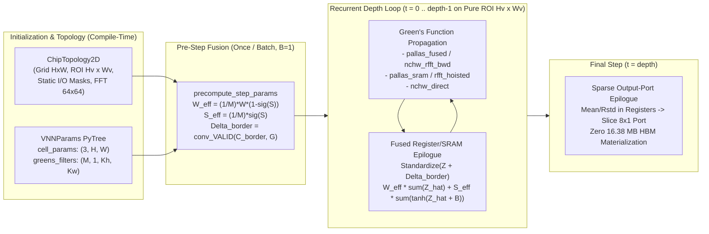

# Neurocell v2: Architecture Reference

**Author**: Shakes  
**Target Platform**: JAX / XLA / Pallas Triton on NVIDIA Ada Lovelace (`SM 8.9`) & Modern GPUs  

---

## 1. Architectural Overview

**Neurocell v2** is a clean-slate, pure-functional JAX redesign of the Von Neumann Network (VNN) cellular array library. Unlike deep learning layers with fixed inter-layer connectivity, a Von Neumann Network learns its own circuit topology on a 2D cellular array of size $H \times W$ using four learnable parameter fields:
1. **Weights** ($W \in \mathbb{R}^{H \times W}$): Passive signal-routing gain per cell.
2. **Biases** ($B \in \mathbb{R}^{H \times W}$): Nonlinear threshold offset per cell.
3. **Codd States** ($S \in \mathbb{R}^{H \times W}$): Continuous architectural role parameter ($\sigma(S) \in [0, 1]$), interpolating between passive wire propagation ($\sigma(S) \to 0$) and active nonlinear decision gating ($\sigma(S) \to 1$).
4. **Green's Function Receptive Fields** ($G \in \mathbb{R}^{M \times 1 \times K_h \times K_w}$): $M$ learnable 2D directional propagation kernels applied across $d$ recurrent temporal steps.

---

## 2. Package Structure

| Module | Primary Classes / Functions | Responsibility |
| :--- | :--- | :--- |
| [`neurocell/topology.py`](../neurocell/topology.py) | `PortSpec`, `CoordinatePortSpec`, `ChipTopology2D` | Immutable chip geometry, active ROI bounds, static boolean I/O masks, `"VALID"`/`"SAME"`/`"CIRCULAR"` boundary modes, and presets (`alu_chip`, `gol_chip`, `clp_chip`, `tm_chip`). |
| [`neurocell/params.py`](../neurocell/params.py) | `VNNParams`, `PrecomputedStepParams`, `init_vnn_params`, `precompute_step_params` | Registered JAX PyTrees packing `(W, B, S)` into `(3, H, W)` and filters into `OIHW` `(M, 1, Kh, Kw)` with optional `roi_bbox` sub-ROI slicing. |
| [`neurocell/adaptive_mask.py`](../neurocell/adaptive_mask.py) | `AdaptiveMaskSpec`, `compute_adaptive_spatial_mask`, `estimate_effective_filter_radii` | Pre-epoch spatial mask estimator (`0.50 ms`) with configurable safety `margin`, `bucket_multiple = 8` quantization, and `prev_mask` containment hysteresis. |
| [`neurocell/filters.py`](../neurocell/filters.py) | `von_neumann_1`, `moore_1`, `sharpen`, `smooth` | Static 2D cellular automaton stencils in `OIHW` layout. |
| [`neurocell/kernels_greens.py`](../neurocell/kernels_greens.py) | `conv2d_batched_nchw`, `rfft2_pruned`, `irfft2_pruned`, `conv2d_grouped_filter_grad`, `hoist_filter_rfft2`, `conv2d_roi_rfft_step`, `conv2d_hybrid_roi_step` | Direct `NCHW`, row-pruned Overlap-Save RFFT, batch-grouped small-kernel filter gradients, and hybrid NCHW/Plancherel-RFFT Green's function operators. |
| [`neurocell/kernels_pallas.py`](../neurocell/kernels_pallas.py) | `pallas_fused_roi_step_epilogue`, `pallas_fused_output_port_epilogue`, `conv2d_hybrid_nopad_roi_step`, `conv2d_pruned_rfft_roi_step` | Custom JAX Pallas / Triton GPU kernels (`SM 8.9`) for single-pass (`<= 8192` pix) & two-stage hardware-tiled (`> 8192` pix) epilogues with pluggable activations and sparse output-port standardization. |
| [`neurocell/epilogue.py`](../neurocell/epilogue.py) | `standardize_spatial_nchw`, `fused_roi_step_epilogue`, `fused_output_port_epilogue` | Pure-JAX XLA fused ROI epilogues and rectangular/coordinate output-port slicing. |
| [`neurocell/propagator.py`](../neurocell/propagator.py) | `select_optimal_backend`, `inject_inputs_2d`, `inject_inputs_roi_2d`, `propagate_vnn_2d` | Stateless multi-step propagation engine supporting all 6 backends (`auto`, `pallas_fused`, `pallas_sram`, `nchw_rfft_bwd`, `rfft_hoisted`, `nchw_direct`) and `spatial_mask` sub-ROI cropping. |
| [`neurocell/model.py`](../neurocell/model.py) | `VonNeumannNetwork` | High-level model API (`init`, `apply`, `compute_spatial_mask`, `effective_states`, `threshold_states`, `save_checkpoint`, `load_checkpoint`). |
| [`neurocell/datasets.py`](../neurocell/datasets.py) | `ALUDeviceDataset`, `generate_arithmetic_logic`, `prepare_alu_device_dataset` | Vectorized NumPy truth-table generation (`142.6x` faster than legacy loop) and single-shot GPU HBM staging. |
| [`neurocell/trainer.py`](../neurocell/trainer.py) | `VNNTrainer`, `packbits_u8_on_device` | `@jax.jit` single-step, `jax.lax.scan` whole-epoch, multi-epoch `train_epochs`, and bucket-cached `train_epoch_adaptive` trainer & evaluator. |

---

## 3. Core Mathematical Abstractions

### 3.1 Factored Pre-Step Parameter Fusion (`PrecomputedStepParams`)
In the original VNN formulation, every temporal step $t \in \{1, \dots, d\}$ and every direction $m \in \{0, \dots, M-1\}$ evaluates:
$$C^{(t)}_b = \frac{1}{M} \sum_{m=0}^{M-1} \Big[(1 - \sigma(S)) \odot (W \odot \hat{Z}^{(t)}_{b,m}) + \sigma(S) \odot \tanh(\hat{Z}^{(t)}_{b,m} + B)\Big]$$
Because $W$, $B$, and $S$ are invariant across the batch $B$, directions $M$, and recurrent depth $d$, [`precompute_step_params`](../neurocell/params.py) factors them outside all three loops into:
$$W_{\text{eff}} = \frac{1}{M} W \odot (1 - \sigma(S_{\text{pinned}})), \qquad S_{\text{eff}} = \frac{1}{M} \sigma(S_{\text{pinned}})$$
so the inner cellular update simplifies to:
$$\mathring{C}^{(t)}_b = W_{\text{eff,roi}} \odot \sum_{m=0}^{M-1} \hat{Z}^{(t)}_{b,m} + S_{\text{eff,roi}} \odot \sum_{m=0}^{M-1} \tanh\!\big(\hat{Z}^{(t)}_{b,m} + B_{\text{roi}}\big)$$

### 3.2 Pure-ROI Decomposition + $B=1$ Hoisted Border Convolution
For a `VALID` convolution of an $(H, W) = (62, 62)$ cellular grid with a $(K_h, K_w) = (23, 13)$ Green's function kernel, only the interior Region-of-Interest (ROI) of shape:
$$(H_v, W_v) = (H - K_h + 1,\; W - K_w + 1) = (40, 50)$$
receives non-zero convolution output. On the outer dead border (48% of the grid), $\hat{Z}^{(t)}_{b,m} \equiv 0$, so the border cells collapse to a batch-, direction-, and step-invariant 2D constant:
$$C_{\text{border}} = \tanh(B) \odot \sigma(S_{\text{pinned}}) \in \mathbb{R}^{H \times W}$$
By linearity of convolution, any full-grid `VALID` convolution decomposes exactly into a `SAME` convolution on the $(40, 50)$ interior ROI plus a **single $B=1$ border convolution** $\Delta_{\text{border}} \in \mathbb{R}^{1 \times M \times H_v \times W_v}$ hoisted outside the depth loop:
$$\text{conv}_{\text{VALID}}\!\big(C^{(t)}_b, G\big) \equiv \text{conv}_{\text{SAME}}\!\big(\mathring{C}^{(t)}_b, G\big) + \Delta_{\text{border}}$$

---

## 4. Execution Backends (`SUPPORTED_BACKENDS`)

| Backend Name | Forward Propagation | Backward $\nabla X$ | Backward $\nabla G$ | Epilogue Execution | Best Use Case |
| :--- | :--- | :--- | :--- | :--- | :--- |
| **`"pallas_fused"`** *(Default)* | Batched `NCHW` cuDNN on $(40, 50)$ ROI | Explicit forward `NCHW` conv with flipped $G_{\text{IOHW}}$ (skipped at $t=0$) | Zero-pad $64\times 64$ RFFT Plancherel inner product + single $M=16$ `irfft2` | Custom Pallas Triton register/SRAM kernels (`pallas_fused_roi_step_epilogue` & `pallas_fused_output_port_epilogue`) | **Fastest overall on small/medium kernels ($K_h K_w \le 350$, including ALU $23\times 13$: `9.26 ms` train, `1.86 ms` infer)** |
| **`"pallas_sram"`** | Pruned separable $64\times 64$ 2D RFFT/IRFFT (slicing $64 \to 40$ rows before 1D `irfft`) | Zero-pad $64\times 64$ RFFT Plancherel reduction ($B=128$ `irfft2` instead of $2,048$) | Zero-pad $64\times 64$ RFFT Plancherel inner product + single $M=16$ `irfft2` | Custom Pallas Triton register/SRAM kernels | **Fastest on large receptive fields ($K_h K_w > 350$, e.g. $27\times 27$ to $45\times 45$, up to `8.85x` faster than spatial conv)** |
| **`"nchw_rfft_bwd"`** | Batched `NCHW` cuDNN on $(40, 50)$ ROI | Explicit forward `NCHW` conv with flipped $G_{\text{IOHW}}$ | $64\times 64$ RFFT Plancherel inner product | Pure-JAX XLA fused ROI epilogue | Pure-JAX fallback when Pallas/Triton is not used (`10.56 ms` train) |
| **`"rfft_hoisted"`** | Hoisted $64\times 64$ Overlap-Save 2D RFFT | $64\times 64$ RFFT Plancherel reduction | $64\times 64$ RFFT Plancherel reduction | Pure-JAX XLA fused ROI epilogue | Pure-JAX spectral backend for large receptive fields |
| **`"nchw_direct"`** | Batched `NCHW` cuDNN on $(40, 50)$ ROI | XLA default `cudnnConvolutionBackwardData` | XLA default `cudnnConvolutionBackwardFilter` | Pure-JAX XLA fused ROI epilogue | Baseline spatial convolution reference (`11.01 ms` train, `2.52 ms` infer) |
