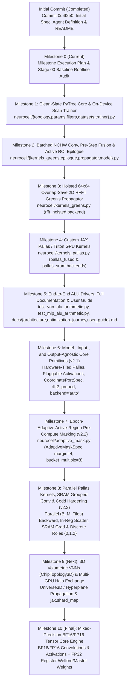

# Neurocell v2 — Milestone Execution & Verification Plan

> [!IMPORTANT]
> **Purpose**: This document defines the stage-by-stage engineering plan, deliverables, verification gates, design decision documentation requirements, and Git commit structure for re-architecting **Neurocell v2** on the **NVIDIA GeForce RTX 4060 Laptop GPU (SM 8.9)** using the `~/Envs/jax-grain` environment (`JAX 0.12.0.1`).

---

## 1. Milestone Overview & Roadmap

---

## 2. Detailed Milestone Specifications

### Milestone 0: Milestone Execution Plan & Baseline Roofline Audit
- **Objective**: Establish the quantitative hardware roofline and empirical baseline metrics for `contrib/test_jax_vnn_alu_arithmetic.py` and `contrib/test_jax_mlp_alu_arithmetic.py` on the RTX 4060 Laptop GPU, and lock in the milestone engineering plan.
- **Deliverables**:
  - `docs/milestone_plan.md` (this document)
  - `docs/stages/stage_00_baseline_audit.md` (Stage 00 Design Decision Record & Empirical Baseline Report)
- **Verification Gate**:
  - Empirical baseline measurements recorded on RTX 4060 (`CudaDevice(id=0)`, `JAX 0.12.0.1`):
    - Legacy VNN Full pure-device train step: **`23.411 ms/batch`** (`5,467.5 samples/s`)
    - Legacy VNN Full Python-loop train step: **`24.350 ms/batch`** (`19.48 s` per 800-batch epoch)
    - Legacy VNN Full un-JITted eval step: **`24.147 ms/batch`** (`5,301.0 samples/s`)
    - Legacy VNN Full JITted inference step: **`1.946 ms/batch`** (`65,786.0 samples/s`)
- **Git Commit**:
  - `docs(milestone-0): add milestone execution plan and stage 00 baseline roofline audit`

---

### Milestone 1: Clean-Slate PyTree Architecture, Static Topology & On-Device `lax.scan` Trainer
- **Objective**: Replace the stateful Haiku `UniverseLP` class and Python batch loops with a pure-functional JAX PyTree architecture (`ChipTopology2D`, `VNNParams`, `PrecomputedStepParams`) and an on-device `jax.lax.scan` training/evaluation harness.
- **Key Design Decisions**:
  1. **Decouple Static Topology (`ChipTopology2D`) from Parameters (`VNNParams`)**: Precompute ROI bounds `(40, 50)` and static boolean pinning masks (`io_state_mask`, `out_weight_mask`) once at initialization time instead of executing 5 `jax.lax.dynamic_update_slice` calls on every forward pass.
  2. **Unified Parameter Packing (`cell_params` of shape `(3, H, W)`)**: Pack `[W, B, S_raw]` into a single contiguous tensor and store Green's filters in native `OIHW` `(M, 1, Kh, Kw)` layout, while supporting `legacy_compat=True` initialization that matches `contrib/` (`VectorCells` and `FiltersCells`) bit-for-bit.
  3. **Whole-Epoch On-Device `jax.lax.scan` (`VNNTrainer`)**: Keep training and test datasets in contiguous device buffers `(num_batches, B, 3, n, 1)` and execute entire epochs and bit-packed evaluations inside `@jax.jit`-compiled `jax.lax.scan` loops.
- **Deliverables**:
  - `neurocell/__init__.py`
  - `neurocell/topology.py`
  - `neurocell/params.py`
  - `neurocell/filters.py`
  - `neurocell/datasets.py`
  - `neurocell/trainer.py`
  - `tests/unit_topology.py`
  - `tests/unit_params.py`
  - `docs/stages/stage_01_clean_pytree_stateless_scan.md`
- **Verification Gate**:
  - `tests/unit_topology.py` passes all geometry, ROI bound, and mask assertions.
  - `tests/unit_params.py` verifies exact numerical equality (`max_abs_diff == 0.0`) between `init_vnn_params(..., legacy_compat=True)` and `contrib/universe.py` initial parameters (`w`, `b`, `s`, `f`).
- **Git Commit**:
  - `feat(core): add ChipTopology2D, VNNParams PyTree, and on-device lax.scan trainer`

---

### Milestone 2: Native Batched `NCHW` Convolution, Pre-Step Parameter Fusion & Active ROI Epilogue
- **Objective**: Eliminate `jax.vmap(B=1)`, eliminate the 48% dead-border `jnp.pad` before Codd gating, factor $(W, S)$ out of the $M=16$ direction reduction, and slice to the 8 output cells on the final step $t=d$.
- **Key Design Decisions**:
  1. **Native Batched `NCHW` Direct Convolution (`nchw_direct`)**: Drive `jax.lax.conv_general_dilated` directly with `(B, 1, H, W)` and `(M, 1, Kh, Kw)` in `NCHW` layout so each `(b, m)` spatial plane `(40, 50)` is contiguous for spatial standardization.
  2. **Pre-Step Parameter Fusion**: Compute $W_{\text{eff}} = \frac{1}{M} W_{\text{pinned}}(1 - \sigma(S_{\text{pinned}}))$ and $S_{\text{eff}} = \frac{1}{M}\sigma(S_{\text{pinned}})$ on the $(40, 50)$ ROI once per batch outside `jax.lax.scan`.
  3. **Active ROI Epilogue & Pure-ROI Linearity Option**: Compute standardization, Codd gating, and $M$-direction reduction strictly on the $40 \times 50 = 2,000$ valid interior cells (cutting 4D tensor size from `31.49 MB` to `16.38 MB` so it fits inside the 24 MB L2 cache, and cutting `tanh` evaluations by 48%).
  4. **Stateless Execution & Output-Only Final Step**: At step $t = d$, slice `z_final` to `roi_out_offset` of shape `(B, M, 8, 1)` immediately after spatial standardization, reducing final-step Codd work by **480x**.
- **Deliverables**:
  - `neurocell/kernels_greens.py` (`conv2d_batched_nchw`)
  - `neurocell/epilogue.py`
  - `neurocell/propagator.py`
  - `neurocell/model.py`
  - `tests/unit_epilogue.py`
  - `tests/unit_vnn_alu_parity.py`
  - `docs/stages/stage_02_batched_nchw_and_roi_epilogue.md`
- **Verification Gate**:
  - `tests/unit_epilogue.py` and `tests/unit_vnn_alu_parity.py` confirm forward outputs and all parameter gradients ($\nabla_W, \nabla_B, \nabla_S, \nabla_G$) match `contrib/` within `< 1e-5` relative error.
  - Benchmark step latency and inference throughput on RTX 4060 vs. Stage 00 baseline (`23.411 ms/batch`).
- **Git Commit**:
  - `perf(propagator): implement batched NCHW conv, pre-step fusion, and active ROI epilogue`

---

### Milestone 3: Hoisted $64 \times 64$ Overlap-Save 2D RFFT Green's Propagator
- **Objective**: Reduce raw 2D convolution FLOPs by **8.35x** ($9.80\text{ GFLOPs} \to 1.17\text{ GFLOPs}$ forward) for large Green's function kernels ($K = 23 \times 13$) using Overlap-Save 2D RFFT with hoisted filter spectra.
- **Key Design Decisions**:
  1. **Exact Overlap-Save Cropping at Radix-2 Size $(64, 64)$**: Because a `VALID` convolution of $(62, 62)$ with $(23, 13)$ only requires output indices $[22:62, 12:62]$, circular wrap-around is confined to $[0:22, :]$ and $[:, 0:12]$. Thus `fft_shape = (64, 64)` produces the exact linear `VALID` convolution with zero circular aliasing.
  2. **Hoisting Filter RFFT Outside Batch ($B=128$) and Depth ($d=4$)**: Compute $\hat{G} = \text{rfft2}(\text{flip}(G, (-2, -1)), s=(64, 64))$ once per batch ($16$ 2D RFFTs instead of $512 \times 16 = 8,192$), and compute only 1 forward RFFT per batch sample per step ($C_{\text{in}} = 1$).
- **Deliverables**:
  - Update `neurocell/kernels_greens.py` (`precompute_filter_rfft2`, `conv2d_valid_rfft_precomputed`)
  - Update `neurocell/propagator.py` & `neurocell/model.py` (`backend="rfft_hoisted"`)
  - `tests/unit_kernels_greens.py`
  - `docs/stages/stage_03_hoisted_rfft_greens.md`
- **Verification Gate**:
  - `tests/unit_kernels_greens.py` verifies forward and backward gradient parity (`< 1e-5` relative error) between `rfft_hoisted`, `nchw_direct`, and `contrib/`.
  - Record RTX 4060 latency and throughput improvements in `stage_03_hoisted_rfft_greens.md`.
- **Git Commit**:
  - `perf(fft): add hoisted 64x64 overlap-save 2D RFFT Green's function backend`

---

### Milestone 4: Custom JAX Pallas / Triton GPU Kernels (Fused Epilogue & Persistent SRAM)
- **Objective**: Eliminate HBM round-trips of the 4D `(B, M, H_v, W_v)` (`16.38 MB`) intermediate tensor during standardization, Codd gating, and direction reduction using custom JAX Pallas / Triton kernels on SM 8.9.
- **Key Design Decisions**:
  1. **Fused Register-Resident Epilogue Kernel (`pallas_fused`)**: Fuse spatial standardization ($\mu_{b,m}, \sigma^{-1}_{b,m}$), `tanh(Z + B_roi)`, and $M=16$ accumulation into a single kernel with a custom `jax.custom_vjp` backward pass that saves only $(\mu_{b,m}, \sigma^{-1}_{b,m})$ (`16 KB` instead of `16.38 MB` per step).
  2. **Persistent Multi-Step SRAM Kernel (`pallas_sram`)**: Exploit the fact that a sample's `62x62` universe (`15.8 KB`) + ROI parameters (`23.4 KB`) + directional filters (`18.7 KB`) = `66.1 KB < 100 KB/SM` Shared Memory on RTX 4060.
- **Deliverables**:
  - `neurocell/kernels_pallas.py`
  - Update `neurocell/propagator.py` & `neurocell/model.py` (`backend="pallas_fused"`, `"pallas_sram"`)
  - `tests/unit_kernels_pallas.py`
  - `docs/stages/stage_04_pallas_sram_kernels.md`
- **Verification Gate**:
  - `tests/unit_kernels_pallas.py` verifies forward and backward gradient parity (`< 1e-5`) against the JAX reference epilogue/propagator.
  - Record RTX 4060 step time, memory footprint, and throughput in `stage_04_pallas_sram_kernels.md`.
- **Git Commit**:
  - `perf(pallas): add custom Pallas GPU kernels for fused epilogue and SRAM execution`

---

### Milestone 5: End-to-End ALU Drivers, Full Documentation Suite & User Guide
- **Objective**: Deliver the production GPU-optimal ALU driver scripts (`test_vnn_alu_arithmetic.py`, `test_mlp_alu_arithmetic.py`), verify full 200-epoch training convergence ($\ge 99.8\%$ accuracy), and complete the architecture reference, optimization journey narrative, and user guide.
- **Deliverables**:
  - `test_vnn_alu_arithmetic.py`
  - `test_mlp_alu_arithmetic.py`
  - `docs/architecture.md`
  - `docs/optimization_journey.md`
  - `docs/user_guide.md`
  - Updated `README.md` with final benchmark table
- **Verification Gate**:
  - Run `test_vnn_alu_arithmetic.py` and `test_mlp_alu_arithmetic.py` in `~/Envs/jax-grain` on the RTX 4060 Laptop GPU, verifying $\ge 99.8\%$ ALU accuracy and recording final end-to-end training time and inference throughput across all backends.
- **Git Commit**:
  - `docs(release): add GPU-optimal ALU drivers, optimization journey, architecture docs, and user guide`

---

### Milestone 6: Model-, Input-, and Output-Agnostic Core Primitives in FP32 (`v2.1`)
- **Objective**: Generalize all Neurocell GPU primitives so every optimization is 100% independent of model topology, grid dimensions, activation function, and I/O port geometry.
- **Key Design Decisions**:
  1. **Single-Pass (`<= 8192` pix) & Two-Stage Hardware-Tiled (`> 8192` pix) Pallas Epilogues**: Stream up to `8,192` pixels in a single pass (`grid = (B,)`) and use Chan's parallel variance combination formula for grids `> 8,192` pixels (`BLOCK_N <= 1024`).
  2. **Pluggable Activations & `has_border: bool` Fast Path**: Support `tanh`, `leaky_relu`, `relu`, `sigmoid`, `gelu`, and `identity` (`None`) inside Pallas forward/backward kernels, and skip redundant $t = 0$ border loads/reductions.
  3. **Universal Port Topologies & Shape-Driven `backend="auto"`**: Add `CoordinatePortSpec`, `"VALID"`/`"SAME"`/`"CIRCULAR"` boundary modes, row-pruned `rfft2_pruned`, batch-grouped `conv2d_grouped_filter_grad`, and `select_optimal_backend`.
- **Deliverables**:
  - Updated `neurocell/{topology,params,kernels_greens,kernels_pallas,epilogue,propagator,trainer}.py`
  - `tests/unit_milestone6_general_vnn.py`
  - `docs/stages/stage_05_model_agnostic_primitives.md`
- **Git Commit**:
  - `59b5746` (`Milestone 6: Model-, input-, and output-agnostic core primitives (v2.1)`)

---

### Milestone 7: Epoch-Adaptive Active-Region Pre-Compute Masking (`v2.2`)
- **Objective**: Exploit the current epoch's learned parameters $(W^{(e)}, B^{(e)}, S^{(e)}, G^{(e)})$ and I/O port anchors to cheaply (`0.50 ms`) estimate the active circuit region + configurable safety `margin` (default `4` cells) for the next epoch without assuming any a priori final network extent.
- **Key Design Decisions**:
  1. **Fused Single-Dispatch Mask Estimator (`_compute_adaptive_mask_tensors`)**: Detect Codd-active cells above the background LayerNorm drift floor (`s_prob > 0.5` and `z_bias_act > salience_threshold`), dilate by `margin`, and quantize `(H_act, W_act)` to `bucket_multiple = 8` with symmetric-slack alignment, tail-bucket absorption, and `prev_mask` containment hysteresis.
  2. **Full-Grid Parameter Invariance**: Keep `VNNParams` (`(3, H, W)` and `(M, 1, Kh, Kw)`) and `opt_state` full-sized and shape-invariant across epochs while slicing per-step convolutions and Pallas epilogues to `roi_bbox`.
- **Deliverables**:
  - `neurocell/adaptive_mask.py`
  - Updated `neurocell/{params,propagator,model,trainer,__init__}.py` and `test_vnn_alu_arithmetic.py` (`--adaptive-margin`)
  - `tests/unit_milestone7_adaptive_mask.py`
  - `docs/stages/stage_06_adaptive_spatial_masking.md`
- **Git Commit**:
  - `5cfa828` (`Milestone 7: Epoch-adaptive active-region pre-compute spatial masking (v2.2)`)

---

### Milestone 8: Parallel `(B, M, Tiles)` Pallas Kernels, SRAM-Resident Grouped Filter Grads & Discrete Codd Hardening (`v2.3`)
- **Objective**: Parallelize the tiled Pallas epilogues across `(B, M, num_tiles)`, fuse in-register sparse output-port backward scatter, dispatch 64-byte aligned SRAM-resident grouped spatial filter gradients (`<= 100 KB/SM`) on compact/adaptive ROIs, and add temperature-annealed / STE discrete Codd state hardening (`{0, 1, 2}`).
- **Key Design Decisions**:
  1. **Parallel `(B, M, num_tiles)` Tiled Pallas & In-Register Sparse Port Scatter**: Launch `grid = (bsz, m_dirs, num_tiles)` for tiled forward/backward epilogues (`9.17x` adaptive speedup on `98x98` grids) and scatter sparse output-port gradients in registers (`port_flat_indices`) inside `_make_sparse_port_bwd_kernel` (`1.51x` faster, zero `.at[...].add()` HBM copy).
  2. **64-Byte Channel-Aligned SRAM Grouped Filter Gradients & Coalesced `jnp.sum` Plancherel Reductions**: Cap `_select_batch_groups` so `b_per_group >= 16` (`64 B` aligned) and dispatch `conv2d_small_kernel_roi_step` when `roi_h * roi_w <= (fh * fw) // 3` (`64 KB <= 100 KB/SM`), cutting 8-bit ALU Adaptive (`margin=4`) step latency to **`5.34 ms/step` (`4.27 s/epoch`, 6.51x faster than `v1`)**.
  3. **Discrete Codd State Hardening (`{0, 1, 2}`)**: Support `SUPPORTED_CODD_MODES = ("continuous", "annealed", "ste_binary", "ste_ternary")` and traced temperature schedules (`VNNTrainer.train_epoch_annealed`).
- **Deliverables**:
  - Updated `neurocell/{kernels_pallas,kernels_greens,params,propagator,model,trainer,__init__}.py` and `test_vnn_alu_arithmetic.py` (`--codd-mode`, `--init-temp`, `--final-temp`)
  - `tests/unit_milestone8_pallas_and_codd.py`
  - `docs/stages/stage_07_parallel_pallas_and_codd_hardening.md`

---

### Milestone 9 (Next): 3D Volumetric VNNs (`ChipTopology3D`), Hyperplane Propagation & Multi-GPU `shard_map` (FP32)
- **Objective**: Extend `ChipTopology`, tiled Pallas epilogues, pruned 3D RFFT (`rfftn_pruned`), and adaptive extent masking to 3D volumetric lattices (`Universe3D` full 3D and hyperplane block propagation), port remaining `contrib/` benchmarks, and support multi-GPU `jax.shard_map` halo exchange.

---

### Milestone 10 (Final Milestone): Mixed-Precision `bfloat16` / `fp16` Tensor Core & L2-Cache Resident Engine
- **Objective**: As a standard orthogonal hardware throughput optimization (applicable to both VNNs and MLPs), accelerate all VNN models by an additional 1.7x–2.2x by running convolutions in `bfloat16`/`fp16` on Tensor Cores and cutting 4D multi-direction activation memory in half while preserving `float32` master weights and `float32` Welford statistics inside the Pallas epilogues.
