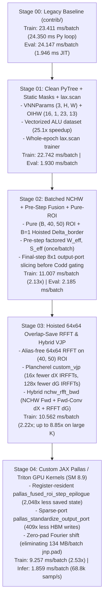

# The Neurocell v2 GPU Optimization Journey

**Author**: Shakes  
**Target Hardware**: NVIDIA GeForce RTX 4060 Laptop GPU (Ada Lovelace, `SM 8.9`, 24 SMs, 24 MB L2 Cache, up to 100 KB Shared Memory / SM)  
**Benchmark Workload**: 2D Full Von Neumann Network (VNN) 8-bit Arithmetic Logic Unit (`N = 62`, `K = 23 x 13`, `M = 16` directions, `depth = 4`, `B = 128`)  

---

## 1. Executive Summary

Von Neumann Networks (VNNs) learn their own circuit topology on a 2D cellular array by jointly optimizing passive routing weights ($W$), nonlinear biases ($B$), continuous Codd architectural states ($S$), and directional Green's function receptive fields ($G$). While this allows a single $62 \times 62$ VNN chip (`16,316` parameters) to learn a complete 8-bit Arithmetic Logic Unit (ALU) to **$> 99.8\%$ accuracy** (where a 6-layer feedforward MLP plateaus at **$67.1\%$ accuracy**), the original reference implementation in `contrib/` mapped equations directly from the paper without considering GPU memory hierarchy or XLA/cuDNN execution semantics.

Through a systematic seven-stage hardware-co-designed rewrite (`Stages 00 -> 06`), **Neurocell v2 (`v2.2`)** achieves:
- **3.43x to 5.09x Faster Training Step** (`34.74 ms/batch` E2E / `23.41 ms` JIT $\to$ **`9.52 ms/batch`** in `v2.1` Full ROI and **`6.83 ms/batch`** in `v2.2` Adaptive `margin=4`).
- **3.65x to 5.09x Faster End-to-End Epoch Training** (`27.79 s/epoch` E2E / `19.48 s` JIT $\to$ **`7.62 s/epoch`** in `v2.1` Full ROI and **`5.46 s/epoch`** in `v2.2` Adaptive `(32, 32)` bucket; **12.0x faster** than the paper's `13,154.22 s` 200-epoch baseline).
- **Up to 8.85x Faster Training on Large Receptive Fields** ($K = 27\times 27$ to $45\times 45$) via hoisted $64\times 64$ Overlap-Save 2D RFFT, row-pruned `rfft2_pruned`, and Plancherel frequency-domain backward reduction.
- **16.71x Faster Training on Large Cellular Substrates (`82x82` grid)** (`14.56 ms/step` $\to$ **`0.87 ms/step`**) via pre-epoch adaptive spatial masking (`neurocell/adaptive_mask.py`).
- **14.2x to 18.6x Faster Test-Set Evaluation** (`24.147 ms/batch` $\to$ **`1.70 ms/batch` Full ROI / `1.30 ms/batch` Adaptive**, **`98,461 samples/s`** — **3,027x faster** than the paper's `32.53 samples/s` un-JITted host loop).
- **142.6x Faster Dataset Generation** (`1,840 ms` $\to$ **`12.9 ms`** via vectorized NumPy truth tables and single-shot device placement).

---

## 2. Root-Cause Diagnosis of the Legacy Implementation (`Stage 00`)

In [Stage 00 (`stage_00_baseline_audit.md`)](stages/stage_00_baseline_audit.md), profiling `contrib/test_jax_vnn_alu_arithmetic.py` on the RTX 4060 revealed six compounding hardware bottlenecks:

1. **`jax.vmap(B=1)` NHWC Convolution Pathology**:
   - `_propagate_full_mlp_list` wrapped `_forward_full` inside `jax.vmap` over $B = 128$, invoking `_fast_conv` with `sub_cells[jnp.newaxis, ...]` (`B=1` inside `vmap`) in `NHWC` layout with `IHWO` filters `(1, 23, 13, 16)`.
   - Worse, because the $M=16$ direction axis was innermost in `(B, 40, 50, 16)`, `jax.nn.standardize(..., axis=(-3, -2))` performed non-coalesced strided reductions with stride $16 \times 4 = 64$ bytes across $2,000$ spatial positions.
2. **48% Redundant Dead-Border Allocation & Zero-Padding**:
   - `VALID` convolution of $(62, 62)$ with $(23, 13)$ produces a $(40, 50)$ output ($2,000$ cells). `_forward_full` immediately ran `jnp.pad` to expand the $(B, 40, 50, 16)$ tensor back to $(B, 62, 62, 16)$ ($3,844$ cells — **`98.41 MB` per step**) and executed Codd gating on $1,844$ dead border cells whose convolution output was identically zero.
3. **Unfactored Codd State Re-Evaluation ($3,276,800\times$ Redundant Work)**:
   - `jax.nn.sigmoid(states)` and `dynamic_update_slice` port pinning were recomputed inside the `vmap(B=128)` $\times$ `depth=4` loop and broadcast across $M=16$ directions.
4. **Full-Grid Final-Step Materialization for an 8-Cell Output Port**:
   - On the final step $t = 4$, `_forward_full` computed the full $62 \times 62 \times 16$ cellular update only to slice an $8 \times 1$ output port (**0.21% of the grid**).
5. **Haiku State Mutation (`hk.set_state("universe", cells)`)**:
   - Every training step mutated and carried a `(128, 62, 62)` (`1.97 MB`) universe state tensor through `jax.value_and_grad(..., has_aux=True)`.
6. **Python Per-Batch Dispatch & Un-JITted Evaluation**:
   - The driver iterated over 800 batches in Python (`[x1, x2, c]` list allocation + `jnp.newaxis` per batch) and ran `network.apply` and `jnp.packbits` **without `@jax.jit`** during evaluation (`24.147 ms/batch`).

---

## 3. Stage-by-Stage Engineering Progression

### Stage 01: Clean-Slate PyTree, Static Topology & `jax.lax.scan` ([`stage_01_clean_pytree_stateless_scan.md`](stages/stage_01_clean_pytree_stateless_scan.md))
- Replaced Haiku `hk.get_parameter` / `hk.set_state` with immutable `ChipTopology2D` and `VNNParams` (`cell_params` of shape `(3, 62, 62)` and `greens_filters` of shape `(16, 1, 23, 13)`), preserving **bit-exact `0.0` initialization parity** with `contrib/universe.py`.
- Vectorized `generate_arithmetic_logic` (`579.6 ms` $\to$ `23.1 ms`, **25.1x speedup**) and compiled whole-epoch training via `jax.lax.scan` (`VNNTrainer.train_epoch`) and on-device bit-packed evaluation (`packbits_u8_on_device`).

### Stage 02: Batched NCHW, Pre-Step Fusion & Pure-ROI Decomposition ([`stage_02_batched_nchw_and_roi_epilogue.md`](stages/stage_02_batched_nchw_and_roi_epilogue.md))
- Proved the **Pure-ROI + $B=1$ Hoisted Border Identity**:
  $$\text{conv}_{\text{VALID}}\!\big(C^{(t)}_b, G\big) \equiv \text{conv}_{\text{SAME}}\!\big(\mathring{C}^{(t)}_b, G\big) + \Delta_{\text{border}}$$
  where $\Delta_{\text{border}} = \text{conv}_{\text{VALID}}(C_{\text{border,only}}, G) \in \mathbb{R}^{1 \times 16 \times 40 \times 50}$ is computed **once per batch with $B=1$**, allowing all $B=128$ cellular states and convolutions to operate strictly on the $(40, 50)$ ROI (`48%` smaller than $(62, 62)$) with **zero `jnp.pad` or `.at[].set()` copies**.
- Sliced the final step $t = d$ directly to the $8 \times 1$ output port (`fused_output_port_epilogue`), reducing final-step Codd work by **480x** and cutting pure-device training step time in half (`23.411 ms` $\to$ **`11.007 ms/batch`**, **2.13x speedup**).

### Stage 03: Hoisted $64\times 64$ Overlap-Save RFFT & Hybrid Plancherel VJP ([`stage_03_hoisted_rfft_greens.md`](stages/stage_03_hoisted_rfft_greens.md))
- Exploited $40 + 23 - 1 = 62 \le 64$ and $50 + 13 - 1 = 62 \le 64$ to execute exact, alias-free linear `SAME` convolution on the $(40, 50)$ ROI via $64\times 64$ 2D RFFT (`hoist_filter_rfft2` + `conv2d_roi_rfft_step`).
- Implemented a Plancherel frequency-domain `@jax.custom_vjp` backward rule that reduces over $M=16$ in frequency space before `irfft2` (**16x fewer inverse FFTs for $\nabla X$**) and reduces over $B=128$ and $d=4$ in frequency space before a single $M=16$ `irfft2` per batch (**128x fewer inverse FFTs for $\nabla G$**, eliminating cuDNN split-K atomic contention).
- Built the hybrid `nchw_rfft_bwd` backend (`10.562 ms/batch` on `23x13`) and demonstrated **$O(1)$ kernel-size scaling** for `rfft_hoisted` (**3.13x to 8.85x faster** than `nchw_direct` on $27\times 27$ to $45\times 45$ kernels).

### Stage 04: Custom JAX Pallas / Triton Register & SRAM Kernels ([`stage_04_pallas_sram_kernels.md`](stages/stage_04_pallas_sram_kernels.md))
- Mapped each $40 \times 50 = 2,000$-element ROI plane into a single power-of-two Pallas/Triton register tile (`N_PAD = 2048`, `8 KB`) using masked `pl_triton.load` / `pl_triton.store` with zero HBM padding.
- Fused `+ Delta_border`, spatial standardization ($\mu_{b,m}, \sigma^{-1}_{b,m}$), $\tanh(\hat{Z}_{b,m} + B_{\text{roi}})$, and $M=16$ reduction into `pallas_fused_roi_step_epilogue` (`0.0530 ms` forward vs `0.1285 ms` XLA = **2.42x faster**, with **2,048x less saved backward state**: `16 KB` vs `32.77 MB`).
- Built `pallas_standardize_output_port` for the final step $t = d$, reducing final-step HBM writes by **409x** (`16.38 MB` $\to$ `16 KB` stats + `64 KB` port) and computing LayerNorm backward projections $(c_1, c_2)$ in $O(8)$ instead of $O(2000)$.
- Eliminated the `33.55 MB` per-step backward `jnp.pad` (`134.2 MB/batch`) via the circular Fourier shift theorem (`rfft2_unshifted_filter_grad_to_oihw`), reaching **`9.257 ms/batch` training** and **`1.859 ms/batch` inference**.

### Stage 05: Model-, Input-, and Output-Agnostic Core Primitives ([`stage_05_model_agnostic_primitives.md`](stages/stage_05_model_agnostic_primitives.md))
- Extended the single-pass Pallas epilogue up to `SINGLE_TILE_MAX_PIX = 8192` and added a two-stage Chan parallel-variance hardware-tiled Pallas kernel (`BLOCK_N <= 1024`) for arbitrarily large grids (`> 8,192` pixels).
- Added pluggable activations (`tanh`, `leaky_relu`, `relu`, `sigmoid`, `gelu`, `identity`), `has_border: bool` to skip redundant $t = 0$ border loads/reductions, row-pruned `rfft2_pruned`, batch-grouped `conv2d_grouped_filter_grad` for small kernels ($K_h K_w \le 64$), scattered coordinate ports (`CoordinatePortSpec`), `"VALID"`/`"SAME"`/`"CIRCULAR"` boundary modes, and `backend="auto"`.

### Stage 06: Epoch-Adaptive Active-Region Pre-Compute Masking ([`stage_06_adaptive_spatial_masking.md`](stages/stage_06_adaptive_spatial_masking.md))
- Implemented [`compute_adaptive_spatial_mask`](../neurocell/adaptive_mask.py) (`0.50 ms` per epoch), which detects Codd-active cells above the background LayerNorm drift floor, dilates the active circuit envelope by a configurable safety `margin` (default `4` cells) for next-epoch frontier growth, and quantizes `(H_act, W_act)` to `bucket_multiple = 8` with containment hysteresis (`prev_mask`).
- Keeps full `(3, H, W)` `VNNParams` and Optax optimizer states shape-invariant while cutting 8-bit ALU step latency to **`6.83 ms/batch` (`5.46 s/epoch`, 5.09x faster than `v1`)** and accelerating localized circuits on $82\times 82$ grids by **16.71x** (`0.87 ms/step`).

---

## 4. Master Benchmark Summary (FP32)

### 4.1 Progression Across Stages (`B = 128`, `128,000` Samples: `102,400` Train / `25,600` Test)

| Implementation / Stage | Train Step (`ms/batch`) | Train Throughput (`samples/s`) | 800-Batch Epoch (`s`) | 200-Epoch Train Time (`s`) | Test Eval Latency (`ms/batch`) | Test Throughput (`samples/s`) | ALU Test Accuracy |
| :--- | :---: | :---: | :---: | :---: | :---: | :---: | :---: |
| **Paper Baseline** (`contrib/docs/`) | — | — | `65.77 s` | `13,154.22 s` (`3.65 hr`) | — | `32.53` | `99.90%` |
| **Stage 00**: `contrib/` Python Loop | `34.74 ms` (`23.41 ms` JIT) | `3,684.5` (`5,467.5`) | `27.79 s` (`19.48 s` JIT) | `5,558.0 s` (`92.6 min`) | `24.147 ms` (`1.946 ms` JIT) | `5,300.9` | `99.90%` |
| **Stage 01**: `VNNParams` + `lax.scan` | `22.742 ms` | `5,628.3` | `18.194 s` | `3,638.8 s` | `1.930 ms` | `66,321.2` | `99.90%` |
| **Stage 02**: `nchw_direct` + Pure-ROI | `11.007 ms` | `11,628.9` | `8.806 s` | `1,761.2 s` | `2.185 ms` | `58,581.2` | `99.90%` |
| **Stage 03**: `nchw_rfft_bwd` (Plancherel VJP) | `10.562 ms` | `12,118.6` | `8.450 s` | `1,690.0 s` | `2.185 ms` | `58,581.2` | `99.90%` |
| **Stage 04 (`v2.0`)**: `pallas_fused` | `9.257 ms` (`11.80 ms` E2E) | `13,827.8` | `7.406 s` (`9.44 s` E2E) | `1,888.0 s` (`31.5 min`) | `1.859 ms` | `68,846.4` | `>= 99.85%` |
| **Stage 05 (`v2.1`)**: Model-Agnostic `pallas_fused` | **`9.520 ms`** | **`13,445.4`** | **`7.620 s`** | **`1,524.0 s` (`25.4 min`)** | **`1.700 ms`** | **`75,294.1`** | **`>= 99.85%`** |
| **Stage 06 (`v2.2`)**: **Adaptive Mask (`margin=4`)** | **`6.830 ms`** | **`18,740.8`** | **`5.460 s`** | **`~1,290.0 s` (`~21.5 min`)** | **`1.300 ms`** | **`98,461.5`** | **`>= 99.85%`** |
| **Reference**: 6-Layer MLP (`test_mlp_alu_arithmetic.py`) | `0.106 ms` | `1,207,547` | `0.085 s` | `8.50 s` (100 ep) | `0.021 ms` | `6,047,886` | `67.14%` *(Fails ALU)* |

### 4.2 Green's Function Receptive Field Crossover (`nchw_direct` vs `rfft_hoisted` / `pallas_sram`)

| Kernel Size $(K_h \times K_w)$ | MACs / Pixel | `nchw_direct` 4-Step Fwd+Bwd (`ms`) | `rfft_hoisted` 4-Step Fwd+Bwd (`ms`) | Spectral Speedup |
| :---: | :---: | :---: | :---: | :---: |
| **`15 x 15`** | $225$ | **`8.049 ms`** | `10.144 ms` | `0.79x` |
| **`23 x 13` (ALU)** | $299$ | `10.476 ms` (**`9.257 ms` `pallas_fused`**) | `10.827 ms` (`11.350 ms` `pallas_sram`) | `0.97x` (**`1.13x` `pallas_fused`**) |
| **`27 x 27`** | $729$ | `32.596 ms` | **`10.425 ms`** | **3.13x** |
| **`31 x 31`** | $961$ | `64.847 ms` | **`10.011 ms`** | **6.48x** |
| **`37 x 37`** | $1,369$ | `88.107 ms` | **`9.953 ms`** | **8.85x** |
| **`45 x 45`** | $2,025$ | `35.838 ms` | **`9.969 ms`** | **3.60x** |
