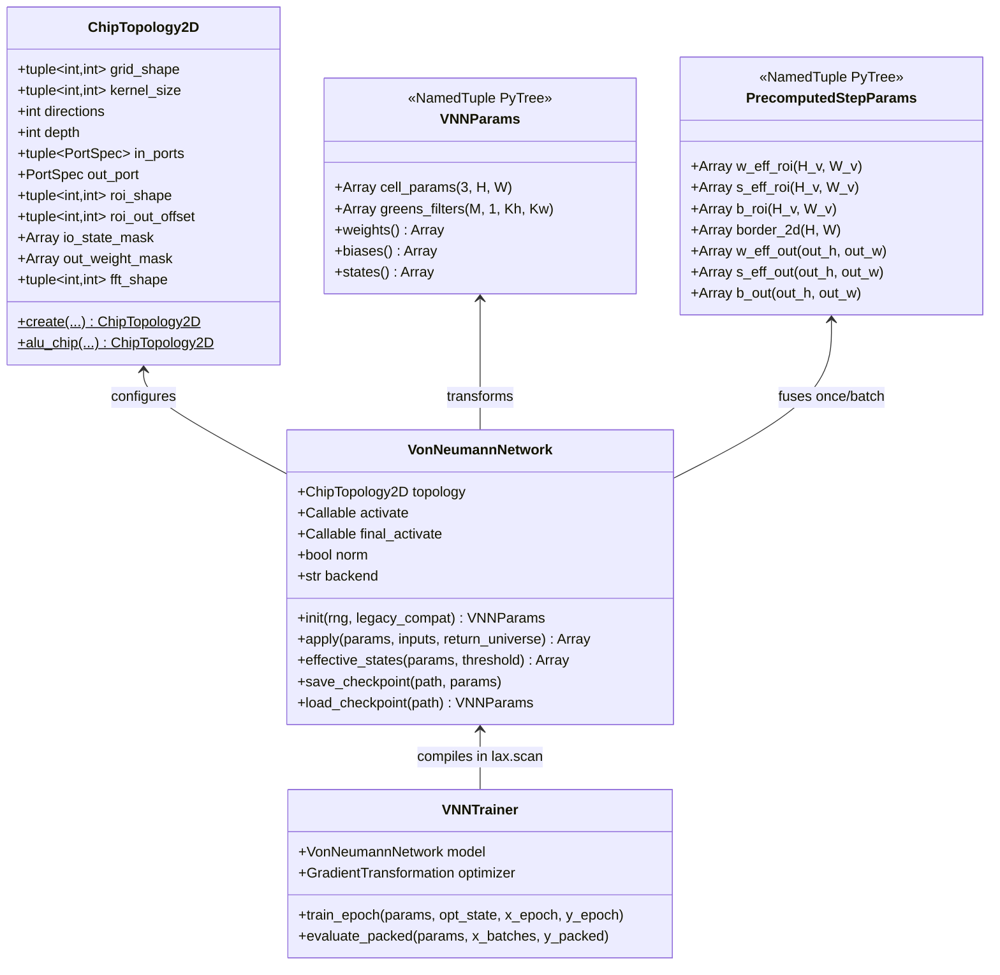
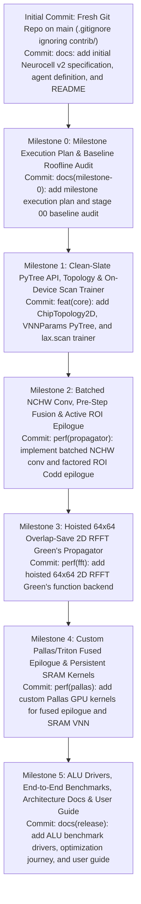

# Technical Specification: Clean-Slate GPU-Optimal Re-Design of Neurocell (v2)

> [!IMPORTANT]
> **Scope of This Specification**: This specification defines a **clean-slate package, file, and class architecture (`neurocell/`)** unconstrained by the legacy `contrib/` design, along with a **new Git repository workflow** featuring atomic milestone commits, per-stage **Design Decision Records (ADRs)**, a complete **Redesign & Optimization Process Log**, **Final Architecture Documentation**, and a **User Guide**. No implementation has been started yet pending your review of this specification.

---

## 1. Hardware Target & Roofline Baseline

Target GPU detected in workspace: **NVIDIA GeForce RTX 4060 Laptop GPU (AD107, Ada Lovelace SM 8.9)**:

| Microarchitectural Resource | RTX 4060 Laptop (SM 8.9) | Architectural Implication for VNN ALU ($N=62, K=23\times 13, M=16, d=4, B=128$) |
| :--- | :--- | :--- |
| **Streaming Multiprocessors** | 24 SMs (3,072 FP32 cores, 96 4th-Gen Tensor Cores) | Needs $\ge 48\text{–}96$ thread blocks to saturate SMs |
| **Peak Compute** | **15.1 TFLOPS** (FP32) / **30.2 TFLOPS** (TF32 TC) / **60.4 TFLOPS** (FP16/BF16 TC) | Theoretical compute floor for ALU VNN step is **1.95 ms** (direct) or **0.23 ms** (FFT), vs. **82.2 ms** actual in `contrib/` (**~2.3% GPU utilization**) |
| **VRAM Bandwidth** | **256 GB/s** peak (~215 GB/s sustained, 128-bit GDDR6) | Ridge point: **59.0 FLOPs/Byte** (FP32). Unfused elementwise passes over 4D `(B, H, W, M)` tensors are strictly memory-bound |
| **L2 Cache** | **24 MB** unified (~1.3 TB/s bandwidth) | Holds a batch of 2D universes `(128, 62, 62)` (`1.97 MB`), but **thrashes** when `(128, 62, 62, 16)` (`31.49 MB`) is materialized |
| **Shared Memory (SRAM) / SM** | **Up to 100 KB configurable SRAM/SM** (128 KB L1/SRAM total) | 1 sample's `62x62` universe (`15.0 KB`) + all VNN parameters (`42.1 KB`) **fit completely inside a single SM's Shared Memory** |

---

## 2. Summary of Legacy Bottlenecks in `contrib/`

In [`contrib/docs/updated_table_1.md`](file:///home/shakes/Work/neurocell-release/contrib/docs/updated_table_1.md), **VNN Full** on the ALU task achieves **99.8% accuracy** (vs. 66.8% for a standard MLP), but takes **13,154.22 s** to train vs. **295.85 s** for the MLP (**44.5x slower**). Our audit identified six compounding software/hardware pathologies in [`contrib/universe.py`](file:///home/shakes/Work/neurocell-release/contrib/universe.py), [`contrib/convs.py`](file:///home/shakes/Work/neurocell-release/contrib/convs.py), [`contrib/forward.py`](file:///home/shakes/Work/neurocell-release/contrib/forward.py), and [`contrib/test_jax_vnn_alu_arithmetic.py`](file:///home/shakes/Work/neurocell-release/contrib/test_jax_vnn_alu_arithmetic.py):

1. **Stateful Haiku Anti-Pattern (`UniverseLP` + `hk.set_state("universe", cells)`)**: Conflates static topology, parameters, and transient batch activations. Writing the `(128, 62, 62)` batch universe (`1.97 MB`) to Haiku state on every step wastes HBM bandwidth and **prevents XLA from dead-code-eliminating non-output cells at the final depth step $t=d$**.
2. **Outer `jax.vmap` Wrapping Single-Sample `B=1` `NHWC` ($C_{\text{in}}=1$) Convolutions**: Forces XLA batch-dimension rewrites, disables cuDNN Tensor Cores, and causes spatial `standardize` to reduce across non-contiguous strided memory (`stride = 16`).
3. **`VALID` Convolution Followed by `jnp.pad` *Before* Codd Gating & Direction Reduction**: Pads $(40, 50)$ back to $(62, 62)$ across all $M=16$ directions, inflating the 4D intermediate tensor from **16.38 MB** to **31.49 MB** (exceeding the 24 MB L2 cache) and executing `tanh` + FMA across **48% dead border cells** where the convolution output is identically zero.
4. **Fragmented Parameter Tensors (`w, b, s`) & Unfactored Direction Gating**: Stores 3 separate parameter matrices, runs 5 `dynamic_update_slice` calls per step, recomputes `sigmoid(states)` at every depth step, and multiplies $(1 - \tilde{S})W$ inside the $M=16$ direction axis instead of factoring $W_{\text{eff}} = \frac{1}{M}(1 - \tilde{S})W$ and $S_{\text{eff}} = \frac{1}{M}\tilde{S}$ out of the direction sum.
5. **Nested `@jax.jit` Decorators & Python-Unrolled Depth Loops**: Prevents cross-operator XLA fusion and inflates compilation/autodiff overhead.
6. **Un-JITted `network.apply` in Evaluation & Python Per-Batch Training Loops**: Calls `network.apply` eagerly 16,200 times during training/testing with host-side `packbits` syncs and 3,200 host-to-device slice transfers per epoch.

---

## 3. Clean-Slate Package, File & Class Design (`neurocell/`)

### 3.1 Design Rationale: Pure Functional JAX PyTrees over Legacy `UniverseLP`
Instead of inheriting the two-step stateful `hk.Module` design (`mlp = UniverseLP(N); mlp.initialize(...); mlp(batch)`), **Neurocell v2** separates concerns into four clean, composable abstractions:



1. **`ChipTopology2D` & `PortSpec` (`neurocell/topology.py`)**:
   - Immutable `@dataclass(frozen=True)` holding all static compile-time geometry (`grid_shape`, `kernel_size`, `directions`, `depth`, `in_ports`, `out_port`), precomputed active ROI bounds `roi_shape = (H - Kh + 1, W - Kw + 1)`, and static boolean pinning masks `io_state_mask` and `out_weight_mask`.
   - Eliminates all runtime `dynamic_update_slice` calls on `states` and `weights`.
2. **`VNNParams` & `PrecomputedStepParams` (`neurocell/params.py`)**:
   - `VNNParams` is a flat `typing.NamedTuple` (native JAX PyTree, zero Haiku/Flax wrapper overhead) containing only two contiguous device arrays:
     - `cell_params`: shape **`(3, H, W)`** packing `[W, B, S_raw]` contiguously in HBM.
     - `greens_filters`: shape **`(M, 1, Kh, Kw)`** in native `OIHW` layout.
   - `PrecomputedStepParams` fuses I/O pinning, `jax.nn.sigmoid(S)`, ROI slicing, and the $\frac{1}{M}$ direction scaling **once per forward pass** before entering the `depth` loop:
     $$W_{\text{eff}} = \frac{1}{M} W_{\text{pinned}}[r_h:H-r_h, r_w:W-r_w] \odot (1 - \tilde{S}_{\text{pinned}}[r_h:H-r_h, r_w:W-r_w])$$
     $$S_{\text{eff}} = \frac{1}{M} \tilde{S}_{\text{pinned}}[r_h:H-r_h, r_w:W-r_w], \qquad B_{\text{roi}} = B[r_h:H-r_h, r_w:W-r_w]$$
3. **Pluggable Green's Propagators & Epilogues (`neurocell/kernels_greens.py`, `epilogue.py`, `kernels_pallas.py`, `propagator.py`)**:
   - Supports 4 interchangeable backends via `VonNeumannNetwork(..., backend=...)`:
     - `"nchw_direct"`: Native batched `lax.conv_general_dilated` in `NCHW` (`(B, 1, H, W)` * `(M, 1, Kh, Kw)`) + factored ROI epilogue.
     - `"rfft_hoisted"`: $64 \times 64$ Overlap-Save 2D RFFT convolution with filter RFFT $\hat{G}$ hoisted outside both the batch ($B=128$) and temporal ($d=4$) loops (**8.35x fewer convolution FLOPs**).
     - `"pallas_fused"`: Custom JAX Pallas/Triton kernel fusing single-pass spatial standardization, `tanh`, and $M$-direction accumulation in registers without writing `(B, M, H_v, W_v)` to HBM.
     - `"pallas_sram"`: Persistent multi-step SRAM kernel keeping the `62x62` universe (`15.8 KB`), ROI parameters (`23.4 KB`), and filters (`18.7 KB`) inside the RTX 4060's `100 KB/SM` Shared Memory across all $d=4$ steps.
4. **`VonNeumannNetwork` & `VNNTrainer` (`neurocell/model.py`, `neurocell/trainer.py`)**:
   - Stateless by default (`return_universe=False`), enabling XLA to dead-code-eliminate all non-output cells at the final step $t=d$ (computing Codd gating on only **8 output cells** instead of 3,844 cells!).
   - When `return_universe=True` is passed (for visualization/inspection), returns `(outputs, universe_history)`.
   - `VNNTrainer` compiles whole-epoch training and bit-packed evaluation on-device via `jax.lax.scan`.

---

### 3.2 Repository Directory Structure

All files follow the conventions in [`vnn_gpu_expert_agent.md`](file:///home/shakes/Work/neurocell-release/vnn_gpu_expert_agent.md) (`snake_case` naming, `test_*` drivers, `unit_*` tests, `'''` module docstrings with `@author Shakes`):

```text
/home/shakes/Work/neurocell-release/
├── vnn_gpu_expert_agent.md           # VNN & GPU/CUDA/XLA Expert Agent definition
├── neurocell/                        # Clean-Slate GPU-Optimal VNN Package (v2)
│   ├── __init__.py                   # Public package exports
│   ├── topology.py                   # PortSpec, ChipTopology2D, HyperplaneTopology, TapeTopology1D
│   ├── params.py                     # VNNParams, PrecomputedStepParams PyTrees & initializers
│   ├── kernels_greens.py             # Batched NCHW conv & Hoisted 64x64 Overlap-Save RFFT conv
│   ├── epilogue.py                   # Factored ROI standardization, Codd gating & output-only final step
│   ├── kernels_pallas.py             # Custom Pallas/Triton fused epilogue & persistent SRAM kernels
│   ├── propagator.py                 # Temporal lax.scan propagation engines dispatching backends
│   ├── model.py                      # Stateless VonNeumannNetwork facade & checkpoint I/O
│   ├── trainer.py                    # Whole-epoch lax.scan trainer & on-device bit-packed evaluator
│   ├── filters.py                    # Discrete stencils (Sobel, Laplacian, sharpen, von Neumann)
│   └── datasets.py                   # Device-ready dataset generators (ALU arithmetic & logic)
├── tests/                            # Unit & Numerical Parity Tests (unit_* prefix)
│   ├── unit_topology.py              # Tests ROI bounds, port validation & static masks
│   ├── unit_params.py                # Tests (3, H, W) packing & bit-exact init parity with contrib/
│   ├── unit_kernels_greens.py        # Tests NCHW conv vs Hoisted 64x64 RFFT vs legacy _fast_conv
│   ├── unit_epilogue.py              # Tests ROI Codd epilogue & 8-cell final slice vs _forward_full
│   ├── unit_kernels_pallas.py        # Tests Pallas fused epilogue & SRAM kernels (fwd + bwd grads)
│   └── unit_vnn_alu_parity.py        # End-to-end forward & gradient parity against contrib/ ALU VNN
├── test_vnn_alu_arithmetic.py        # GPU-optimal 2D Full VNN ALU driver script (test_* prefix)
├── test_mlp_alu_arithmetic.py        # GPU-optimal on-device lax.scan MLP baseline driver script
├── docs/                             # Redesign, Stage ADRs, Architecture & User Guide Documentation
│   ├── architecture.md               # Complete technical reference of the final Neurocell v2 design
│   ├── user_guide.md                 # End-to-end user & developer guide with code examples
│   ├── optimization_journey.md       # Narrative & roofline progression of the redesign & optimization
│   └── stages/                       # Per-stage Design Decision Records (ADRs) & benchmark logs
│       ├── stage_00_baseline_audit.md
│       ├── stage_01_clean_pytree_stateless_scan.md
│       ├── stage_02_batched_nchw_and_roi_epilogue.md
│       ├── stage_03_hoisted_rfft_greens.md
│       └── stage_04_pallas_sram_kernels.md
└── contrib/                          # Legacy Paper-Mapped Implementation & Paper PDF (Read-Only Reference)
```

---

## 4. New Git Repository & Milestone Commit Workflow

We will replace the existing `.git` directory in `/home/shakes/Work/neurocell-release` with a fresh `git init -b main`, configure `.gitignore` to ignore the local `contrib/` reference folder, commit the initial specification (`docs/specification.md`) and initial `README.md`, and then execute **6 atomic, benchmark-verified milestone commits**:



| Milestone | Deliverables | Verification Gate Before `git commit` | Stage Documentation Artifact |
| :--- | :--- | :--- | :--- |
| **Initial Commit**<br/>Repo Init & Spec | Fresh `git init -b main`, `.gitignore` (ignoring `contrib/`), `README.md`, `vnn_gpu_expert_agent.md`, `docs/specification.md` | Verify `git status` is clean and `contrib/` is ignored | `docs/specification.md`,<br/>`README.md` |
| **Milestone 0**<br/>Milestone Plan & Baseline Audit | Detailed Milestone Plan (`docs/milestone_plan.md`) + Stage 00 Baseline Roofline Audit (`docs/stages/stage_00_baseline_audit.md`) | Record baseline step time, epoch time, and FLOP/HBM roofline of `contrib/` on RTX 4060 Laptop GPU; verify milestone plan | `docs/milestone_plan.md`,<br/>`docs/stages/stage_00_baseline_audit.md` |
| **Milestone 1**<br/>Clean-Slate PyTree & `lax.scan` Core | `topology.py`, `params.py`, `filters.py`, `datasets.py`, `trainer.py`, `unit_topology.py`, `unit_params.py` | Pass `unit_topology.py` and verify bit-exact initialization parity (`unit_params.py`) with legacy `VectorCells` | `docs/stages/stage_01_clean_pytree_stateless_scan.md` |
| **Milestone 2**<br/>Batched `NCHW` Conv & ROI Epilogue | `kernels_greens.py` (`nchw_direct`), `epilogue.py`, `propagator.py`, `model.py`, `unit_epilogue.py`, `unit_vnn_alu_parity.py` | Forward outputs and all 4 parameter gradients ($\nabla_W, \nabla_B, \nabla_S, \nabla_G$) match `contrib/` within `< 1e-5`; benchmark step speedup (~25x) | `docs/stages/stage_02_batched_nchw_and_roi_epilogue.md` |
| **Milestone 3**<br/>Hoisted $64\times 64$ 2D RFFT Backend | `kernels_greens.py` (`rfft_hoisted`), `unit_kernels_greens.py` | Forward & backward parity `< 1e-5` between `rfft_hoisted` and `nchw_direct`; verify 8.35x conv FLOP reduction & ~43x step speedup | `docs/stages/stage_03_hoisted_rfft_greens.md` |
| **Milestone 4**<br/>Pallas / Triton Custom GPU Kernels | `kernels_pallas.py` (`pallas_fused`, `pallas_sram` + custom VJP), `unit_kernels_pallas.py` | Forward & backward custom VJP gradient parity `< 1e-5` against JAX reference; benchmark sub-millisecond step latency | `docs/stages/stage_04_pallas_sram_kernels.md` |
| **Milestone 5**<br/>ALU Drivers & Full Documentation Suite | `test_vnn_alu_arithmetic.py`, `test_mlp_alu_arithmetic.py`, `docs/architecture.md`, `docs/optimization_journey.md`, `docs/user_guide.md` | Full 200-epoch ALU VNN training converges to $\ge 99.8\%$ accuracy in `~/Envs/jax-grain`; complete all final documentation | `docs/architecture.md`,<br/>`docs/optimization_journey.md`,<br/>`docs/user_guide.md` |

---

## 5. Documentation Suite Specification (`docs/`)

### 5.1 Per-Stage Design Decision Records (`docs/stages/stage_00..04_*.md`)
Created and committed alongside each milestone, each Stage ADR documents:
1. **Context & Problem Statement**: Specific bottleneck targeted in that stage.
2. **Design Decisions & Justifications**:
   - Why each data structure, tensor layout (`(3, H, W)`, `OIHW`, `NCHW`), or algorithm (48% dead-border ROI decomposition, $\frac{1}{M}$ pre-step factoring, $64\times 64$ overlap-save RFFT hoisting, Pallas register/SRAM tiling) was chosen.
   - Mathematical proof of exact equivalence to Equations (4)–(5) of the VNN paper ([`2605.05780v2.pdf`](file:///home/shakes/Work/neurocell-release/contrib/2605.05780v2.pdf)).
3. **Alternatives Considered & Rejected**: Why alternative approaches (e.g., `NHWC` with $C_{\text{in}}=1$, circular FFT without overlap-save cropping, stateful Haiku carries) were rejected.
4. **Quantitative Verification & Roofline Impact**:
   - Numerical parity table (max absolute error and relative L2 error on outputs and gradients vs. `contrib/`).
   - Before/after metrics on RTX 4060: step latency (ms), epoch time (s), throughput (samples/s), HBM traffic (MB/step), and GPU utilization (%).

### 5.2 Redesign & Optimization Process Log (`docs/optimization_journey.md`)
A cohesive engineering document chronicling the entire redesign process from start to finish:
- **Baseline Profiling & Roofline Analysis**: How the 6 pathologies in `contrib/` caused a 44.5x slowdown despite VNNs having only 16,316 parameters.
- **The Optimization Waterfall**: Step-by-step progression across Stages 1–4 with Mermaid diagrams, latency/throughput tables, and memory hierarchy analysis (GDDR6 HBM $\to$ 24 MB L2 $\to$ 100 KB SM Shared Memory $\to$ Registers).
- **Comparative Benchmark Summary**: Side-by-side comparison of `contrib/` VNN Full, Neurocell v2 (`nchw_direct`, `rfft_hoisted`, `pallas_fused`, `pallas_sram`), and the deep learning MLP baseline on the ALU arithmetic task.

### 5.3 Final Design Reference (`docs/architecture.md`)
Authoritative technical documentation of the final **Neurocell v2** system:
- Architectural overview, module dependency graph, and PyTree class hierarchy.
- Mathematical formulation of Pre-Step Parameter Fusion, Active ROI Decomposition, Output-Only Final Step Slicing, and Overlap-Save RFFT Green's Propagation.
- Hardware mapping guide for NVIDIA Ada Lovelace / Ampere / Hopper GPUs.
- Guide for extending Neurocell v2 to 1D Turing Machine tapes, Circular Layered Perceptrons (CLPs), and 3D Hyperplane classifiers.

### 5.4 User Guide (`docs/user_guide.md`)
Practical guide for researchers and practitioners using Neurocell v2:
1. **Installation & Environment Setup** (`~/Envs/jax-grain`).
2. **Quickstart: Training a 2D ALU Chip VNN in 25 Lines of Code**.
3. **Defining Custom Cellular Topologies & I/O Ports** (`PortSpec`, `ChipTopology2D.create`).
4. **Selecting & Tuning Propagation Backends** (`"nchw_direct"`, `"rfft_hoisted"`, `"pallas_fused"`, `"pallas_sram"`).
5. **Visualizing Self-Engineered Architectures**: Plotting Codd state roles (Active Gates vs. Passive Signal Wires), weight fields, and learned directional Green's functions.
6. **Hardware Damage & Self-Repair (Everything-on-Chip / EoC)**: Masking damaged cells (`S_raw = -inf`) and fine-tuning self-healing circuits.
7. **Legacy Compatibility**: Loading and exporting `.npz` checkpoints compatible with `contrib/` visualization scripts.
