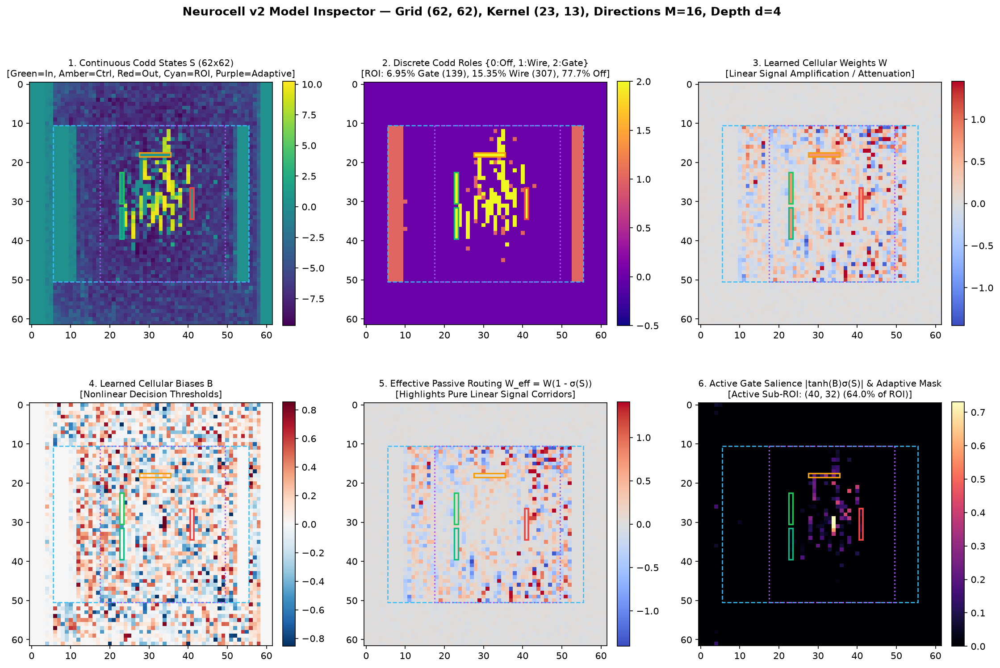

# Neurocell v2 (`v2.3`): Comprehensive User & Training Guide

**Author**: Shakes  
**Python Environment**: `/home/shakes/Envs/jax-grain/bin/python` (`JAX >= 0.12`, `optax`, `haiku`, `matplotlib`, `numpy`)  

---

## Table of Contents

1. [Environment & Quickstart Summary](#1-environment--quickstart-summary)
2. [Training the 2D VNN 8-Bit ALU (`test_vnn_alu_arithmetic.py`)](#2-training-the-2d-vnn-8-bit-alu-test_vnn_alu_arithmeticpy)
3. [Training the 6-Layer Dense MLP Baseline (`test_mlp_alu_arithmetic.py`)](#3-training-the-6-layer-dense-mlp-baseline-test_mlp_alu_arithmeticpy)
4. [Training Other VNN Architectures (`gol_chip`, `clp_chip`, `mlp_chip`, `tm_chip`, Custom Grids)](#4-training-other-vnn-architectures-gol_chip-clp_chip-mlp_chip-tm_chip-custom-grids)
5. [GPU Backends & Automatic Cost-Model Dispatch (`SUPPORTED_BACKENDS`)](#5-gpu-backends--automatic-cost-model-dispatch-supported_backends)
6. [Epoch-Adaptive Spatial Masking & Discrete Codd Role Hardening (`{0, 1, 2}`)](#6-epoch-adaptive-spatial-masking--discrete-codd-role-hardening-0-1-2)
7. [Checkpoints, Visual Dashboard & Unit Test Suite](#7-checkpoints-visual-dashboard--unit-test-suite)

---

## 1. Environment & Quickstart Summary

All Neurocell v2 scripts and tests run in the `~/Envs/jax-grain` conda/virtualenv environment:

```bash
# 1. Verify all 33 unit & numerical parity tests pass
~/Envs/jax-grain/bin/python -m unittest discover -s tests -p "unit_*.py" -v

# 2. Fastest 8-Bit ALU VNN training (Adaptive Mask margin=4 + Parallel Pallas/SRAM -> ~4.27s/epoch)
~/Envs/jax-grain/bin/python test_vnn_alu_arithmetic.py --epochs 200 --backend pallas_fused --adaptive-margin 4

# 3. 8-Bit ALU VNN training with STE Discrete Codd Role Hardening ({0, 1, 2} roles)
~/Envs/jax-grain/bin/python test_vnn_alu_arithmetic.py --epochs 200 --backend pallas_fused --adaptive-margin 4 --codd-mode ste_ternary

# 4. Standard Full-ROI 8-Bit ALU VNN training (~7.62s/epoch)
~/Envs/jax-grain/bin/python test_vnn_alu_arithmetic.py --epochs 200 --backend pallas_fused

# 5. 6-Layer Dense MLP ALU baseline (100 epochs in ~8.5s; plateaus at ~67.1% accuracy)
~/Envs/jax-grain/bin/python test_mlp_alu_arithmetic.py --epochs 100

# 6. Explore & animate a trained VNN checkpoint (PNG overview, GIF wave animation & HTML explorer)
~/Envs/jax-grain/bin/python visualize_vnn_model.py --checkpoint alu_arithmetic_cells.npz --x1 42 --x2 21 --op add

# 7. Generate the v1 vs v2 interactive HTML & PNG comparison dashboard
~/Envs/jax-grain/bin/python generate_v1_vs_v2_dashboard.py
```

---

## 2. Training the 2D VNN 8-Bit ALU (`test_vnn_alu_arithmetic.py`)

[`test_vnn_alu_arithmetic.py`](../test_vnn_alu_arithmetic.py) trains the canonical $62 \times 62$ Von Neumann Network ($K = 23 \times 13$ Green's filter, $M = 16$ directions, `depth = 4`, `16,316` parameters) on 128,000 8-bit arithmetic and logic samples.

### 2.1 Common Training Modes

#### Mode A: Fastest Adaptive-Mask Training (`v2.3` Recommended — **6.51x faster than `v1`**)
Uses pre-epoch Codd salience estimation (`0.50 ms/epoch`), a `+4`-cell safety margin for circuit growth, bucket-quantized ROI cropping (`bucket_multiple=8`), and 64-byte aligned SRAM grouped filter gradients:
```bash
# Quick 30-epoch convergence check (~2.1 minutes total, reaches >98.3% test accuracy)
~/Envs/jax-grain/bin/python test_vnn_alu_arithmetic.py \
    --epochs 30 \
    --eval-every 5 \
    --backend pallas_fused \
    --adaptive-margin 4

# Full 200-epoch training run (~17.5 minutes total, reaches ~99.9% test accuracy)
~/Envs/jax-grain/bin/python test_vnn_alu_arithmetic.py \
    --epochs 200 \
    --eval-every 10 \
    --backend pallas_fused \
    --adaptive-margin 4 \
    --output-npz alu_vnn_adaptive_200ep.npz
```

#### Mode B: Discrete Codd State Hardening (`{0, 1, 2}` Roles via STE or Temperature Annealing)
Hardens continuous Codd states during training so every cell in the forward pass operates as an exact discrete Codd role (`0`: Confluent/Off, `1`: Passive Wire, `2`: Active Nonlinear Gate) with zero post-training thresholding accuracy loss:
```bash
# Ternary Straight-Through Estimator (STE) hardening into {0, 1, 2} (probs {0.0, 0.5, 1.0})
~/Envs/jax-grain/bin/python test_vnn_alu_arithmetic.py \
    --epochs 200 \
    --backend pallas_fused \
    --adaptive-margin 4 \
    --codd-mode ste_ternary \
    --init-temp 1.0 \
    --final-temp 0.2 \
    --output-npz alu_vnn_ste_ternary.npz

# Binary Straight-Through Estimator (STE) hardening into {0, 1}
~/Envs/jax-grain/bin/python test_vnn_alu_arithmetic.py \
    --epochs 200 \
    --backend pallas_fused \
    --adaptive-margin 4 \
    --codd-mode ste_binary \
    --init-temp 1.0 \
    --final-temp 0.2

# Smooth temperature-annealed sigmoid (tau: 1.0 -> 0.15)
~/Envs/jax-grain/bin/python test_vnn_alu_arithmetic.py \
    --epochs 200 \
    --backend pallas_fused \
    --adaptive-margin 4 \
    --codd-mode annealed \
    --init-temp 1.0 \
    --final-temp 0.15
```

#### Mode C: Full-ROI Baseline (`40x50` Active Interior, Bitwise-Grade Parity with Legacy `v1`)
Evaluates the entire $40 \times 50$ valid interior ROI on every step without spatial cropping:
```bash
~/Envs/jax-grain/bin/python test_vnn_alu_arithmetic.py \
    --epochs 200 \
    --backend pallas_fused \
    --output-npz alu_vnn_full_roi.npz
```

#### Mode D: Comparing Different GPU Backends
```bash
# Analytical Roofline Auto-Dispatcher
~/Envs/jax-grain/bin/python test_vnn_alu_arithmetic.py --epochs 30 --backend auto

# Pallas Epilogue + Pruned 64x64 2D RFFT Spectral Convolution (O(1) in kernel size)
~/Envs/jax-grain/bin/python test_vnn_alu_arithmetic.py --epochs 30 --backend pallas_sram

# Pure-JAX Batched NCHW Forward + Plancherel RFFT Filter Backward (no Triton required)
~/Envs/jax-grain/bin/python test_vnn_alu_arithmetic.py --epochs 30 --backend nchw_rfft_bwd

# Pure-JAX Hoisted 64x64 Overlap-Save 2D RFFT
~/Envs/jax-grain/bin/python test_vnn_alu_arithmetic.py --epochs 30 --backend rfft_hoisted

# Pure-JAX Batched NCHW Direct Spatial Convolution
~/Envs/jax-grain/bin/python test_vnn_alu_arithmetic.py --epochs 30 --backend nchw_direct
```

### 2.2 Complete CLI Reference for `test_vnn_alu_arithmetic.py`

| Flag | Default | Choices / Type | Description |
| :--- | :---: | :---: | :--- |
| `--epochs` | `200` | `int` | Number of training epochs (`800` batches/epoch at default `samples=128000`). |
| `--samples` | `128000` | `int` | Total dataset samples (`80%` train = `102,400`, `20%` test = `25,600`). |
| `--batch-size` | `128` | `int` | Mini-batch size on GPU. |
| `--backend` | `"pallas_fused"` | `pallas_fused`, `pallas_sram`, `rfft_hoisted`, `nchw_rfft_bwd`, `nchw_direct`, `auto` | GPU execution backend for Green's function convolution and Codd epilogue. |
| `--adaptive-margin` | `None` | `int` (e.g. `4`) | Enables Epoch-Adaptive Active-Region Pre-Compute Masking with `+margin` cells of safety padding around salient Codd cells. |
| `--codd-mode` | `"continuous"` | `continuous`, `annealed`, `ste_binary`, `ste_ternary` | Codd cellular state gating mode (`ste_ternary` hardens states into `{0, 1, 2}`). |
| `--init-temp` | `1.0` | `float` | Initial sigmoid temperature $\tau_0$ when `--codd-mode != "continuous"`. |
| `--final-temp` | `0.2` | `float` | Final sigmoid temperature $\tau_F$ at the end of training. |
| `--eval-every` | `10` | `int` | Evaluate bit-packed 8-bit integer training accuracy every $N$ epochs. |
| `--output-npz` | `"alu_arithmetic_cells.npz"` | `str` | Output checkpoint path (compatible with `VonNeumannNetwork.load_checkpoint` and `contrib/`). |
| `--no-plots` | `False` | flag | Skip saving PNG visualizations (`vnn_alu_arithmetic_*.png`). |

---

## 3. Training the 6-Layer Dense MLP Baseline (`test_mlp_alu_arithmetic.py`)

[`test_mlp_alu_arithmetic.py`](../test_mlp_alu_arithmetic.py) trains the 6-layer LayerNorm + ReLU dense MLP (`24 -> 20 -> 16 -> 12 -> 10 -> 8`, `1,978` parameters) from `contrib/test_jax_mlp_alu_arithmetic.py` using Neurocell v2's vectorized dataset generator and on-device `jax.lax.scan` trainer:

```bash
# Default 100-epoch MLP baseline (~8.5 seconds total; plateaus at ~67.14% test accuracy)
~/Envs/jax-grain/bin/python test_mlp_alu_arithmetic.py --epochs 100 --eval-every 10

# Custom sample count or batch size
~/Envs/jax-grain/bin/python test_mlp_alu_arithmetic.py --epochs 200 --samples 128000 --batch-size 128
```

---

## 4. Training Other VNN Architectures (`gol_chip`, `clp_chip`, `mlp_chip`, `tm_chip`, Custom Grids)

Neurocell v2 (`v2.3`) is 100% model-, input-, and output-agnostic. Through [`ChipTopology2D`](../neurocell/topology.py), [`VonNeumannNetwork`](../neurocell/model.py), and [`VNNTrainer`](../neurocell/trainer.py), you can train any 2D VNN architecture in a few lines of Python.

### 4.1 Full-Grid Cellular Automaton / Conway's Game of Life (`ChipTopology2D.gol_chip`)

In full-grid cellular automata (`input_size == output_size == grid_shape`), every cell on the $N \times N$ board is both an input and an output. Neurocell's Pallas kernels support `leaky_relu` (and `relu`, `sigmoid`, `gelu`, `tanh`, `None`) and automatically hoist static borders for steps $t \ge 1$:

```python
import jax
import jax.numpy as jnp
import optax
from neurocell import ChipTopology2D, VonNeumannNetwork, VNNTrainer

# 1. Define a 64x64 Full-Grid Game of Life topology (K=3x3, M=64 directions, depth=2)
gol_topo = ChipTopology2D.gol_chip(
    grid_shape=(64, 64),
    kernel_size=(3, 3),
    directions=64,
    depth=2,
    padding_mode="VALID",  # or "SAME" / "CIRCULAR" for toroidal boundary conditions
)

# 2. Instantiate VonNeumannNetwork with leaky_relu activation and auto/Pallas backend
model = VonNeumannNetwork(
    topology=gol_topo,
    activate=jax.nn.leaky_relu,
    norm=True,
    backend="pallas_fused",
)
params = model.init(jax.random.PRNGKey(0))

# 3. Synthetic (or RLE-loaded) Game of Life transitions:
#    x_epoch shape: (num_batches, B, 1, 64, 64)
#    y_epoch shape: (num_batches, B, 64, 64)
rng = jax.random.PRNGKey(1)
x_boards = jax.random.bernoulli(rng, p=0.25, shape=(20, 64, 1, 64, 64)).astype(jnp.float32)
# Example target: 1-step toroidal Conway's Game of Life rule
neighbors = sum(
    jnp.roll(x_boards[:, :, 0], shift=(dr, dc), axis=(-2, -1))
    for dr in (-1, 0, 1)
    for dc in (-1, 0, 1)
    if (dr, dc) != (0, 0)
)
y_boards = jnp.where(
    (neighbors == 3) | ((x_boards[:, :, 0] == 1.0) & (neighbors == 2)),
    1.0,
    0.0,
)

# 4. Train on-device with VNNTrainer
optimizer = optax.adamw(learning_rate=3e-3)
trainer = VNNTrainer(apply_fn=model.apply, optimizer=optimizer, batch_size=64)
opt_state = trainer.optimizer.init(params)

for epoch in range(1, 11):
    params, opt_state, loss = trainer.train_epoch(params, opt_state, x_boards, y_boards)
    cell_acc = trainer.evaluate_metric(params, x_boards, y_boards)
    print(f"[GoL Epoch {epoch:2d}] Loss: {float(loss):.6f} | Cell Accuracy: {float(cell_acc):.4%}")
```

---

### 4.2 Circular Layered Perceptron / Coordinate-Port XOR (`ChipTopology2D.clp_chip`)

For models where inputs and outputs are scattered `(row, col)` coordinates rather than rectangular slices (matching `CoordinateCells` in `contrib/test_jax_vnn_clp_classify_xor.py`), use [`CoordinatePortSpec`](../neurocell/topology.py) or `ChipTopology2D.clp_chip`:

```python
import jax
import jax.numpy as jnp
import optax
from neurocell import ChipTopology2D, VonNeumannNetwork, VNNTrainer

# 1. Build an 8x8 Coordinate-Addressed CLP chip (2 input coords, 2 output class coords)
clp_topo = ChipTopology2D.clp_chip(
    grid_shape=(8, 8),
    in_coords=((2, 2), (5, 2)),   # 2 scattered input cells
    out_coords=((2, 5), (5, 5)),  # 2 scattered output class cells
    kernel_size=(3, 3),
    directions=16,
    depth=6,
)

model = VonNeumannNetwork(topology=clp_topo, backend="pallas_fused")
params = model.init(jax.random.PRNGKey(42))

# 2. Prepare noisy XOR classification batches:
#    x_epoch shape: (num_batches, B, 1, num_in_coords, 1) -> (10, 64, 1, 2, 1)
#    y_epoch shape: (num_batches, B, num_out_coords, 1)   -> (10, 64, 2, 1) one-hot
k1, k2 = jax.random.split(jax.random.PRNGKey(7))
bits = jax.random.bernoulli(k1, 0.5, shape=(10, 64, 1, 2, 1)).astype(jnp.float32)
x_xor = bits + 0.1 * jax.random.normal(k2, bits.shape)
xor_label = jnp.logical_xor(bits[:, :, 0, 0, 0] > 0.5, bits[:, :, 0, 1, 0] > 0.5).astype(jnp.int32)
y_xor = jax.nn.one_hot(xor_label, num_classes=2, dtype=jnp.float32)[..., jnp.newaxis]

# 3. Use top-1 classification accuracy metric
def top1_acc(logits: jax.Array, targets: jax.Array) -> jax.Array:
    return jnp.mean(jnp.argmax(logits[:, :, 0], axis=-1) == jnp.argmax(targets[:, :, 0], axis=-1))

trainer = VNNTrainer(
    apply_fn=model.apply,
    optimizer=optax.adamw(5e-3),
    batch_size=64,
    eval_metric_fn=top1_acc,
)
opt_state = trainer.optimizer.init(params)

for epoch in range(1, 21):
    params, opt_state, loss = trainer.train_epoch(params, opt_state, x_xor, y_xor)
    if epoch % 5 == 0:
        acc = trainer.evaluate_metric(params, x_xor, y_xor)
        print(f"[CLP XOR Epoch {epoch:2d}] Loss: {float(loss):.6f} | Top-1 Acc: {float(acc):.2%}")
```

---

### 4.3 Vertical 2D MLP Chip (`ChipTopology2D.mlp_chip`) & 2D Turing Machine Tape (`ChipTopology2D.tm_chip`)

Neurocell includes built-in presets for the **Vertical 2D MLP Chip** (`contrib/test_jax_vnn_mlp_arithmetic.py`) and the **2D Turing Machine Tape** (`contrib/test_jax_vnn_tm_arithmetic.py`):

```python
import jax
import jax.numpy as jnp
import optax
from neurocell import ChipTopology2D, VonNeumannNetwork, VNNTrainer

# --- Option A: Vertical 2D MLP Chip (50x50 grid, K=17x3, M=8, depth=11) ---
mlp_chip_topo = ChipTopology2D.mlp_chip(
    n=8,
    layers=5,
    ctrl_gap=1,
    kernel_size=(17, 3),
    directions=8,
)
mlp_vnn = VonNeumannNetwork(topology=mlp_chip_topo, backend="pallas_fused")
mlp_params = mlp_vnn.init(jax.random.PRNGKey(0))
# Input port shape: (B, 1, 25, 1) -> Output port shape: (B, 8, 1)

# --- Option B: 2D Turing Machine Tape Chip (68x68 grid, K=13x13, M=16, depth=17) ---
tm_topo = ChipTopology2D.tm_chip(
    n=8,
    kernel_size=(13, 13),
    directions=16,
    gap=1,
)
tm_vnn = VonNeumannNetwork(topology=tm_topo, backend="pallas_fused")
tm_params = tm_vnn.init(jax.random.PRNGKey(0))
# Input tape shape: (B, 1, 1, 16) -> Output tape shape: (B, 1, 8)
```

---

### 4.4 Large-Scale Multi-Tile Grids (`> 8,192` ROI Pixels, e.g., `98x98` or `128x128`)

When the active ROI exceeds `8,192` pixels (e.g., a `98x98` grid with a `96x96 = 9,216`-pixel ROI, or a `128x128` grid with `16,384` pixels), Neurocell automatically dispatches the **Parallel `(B, M, num_tiles)` Two-Stage Chan Hardware-Tiled Pallas Kernel** (`BLOCK_N = 1024`). Combining this with Epoch-Adaptive Spatial Masking (`margin=4`) yields **9.17x–16.71x speedups**:

```python
import jax
import jax.numpy as jnp
import optax
from neurocell import ChipTopology2D, PortSpec, VonNeumannNetwork, VNNTrainer

# 98x98 cellular substrate -> 96x96 active ROI (9,216 pixels > 8,192 single-pass limit)
large_topo = ChipTopology2D.create(
    grid_shape=(98, 98),
    kernel_size=(3, 3),
    directions=16,
    depth=4,
    in_ports=[PortSpec(offset=(40, 40), size=(8, 1), name="in")],
    out_port=PortSpec(offset=(40, 52), size=(8, 1), name="out"),
)

model = VonNeumannNetwork(topology=large_topo, backend="pallas_fused")
params = model.init(jax.random.PRNGKey(42), clear_outside_io=True)

x_train = jax.random.normal(jax.random.PRNGKey(1), (10, 64, 1, 8, 1))
y_train = jax.random.normal(jax.random.PRNGKey(2), (10, 64, 8, 1))

trainer = VNNTrainer(apply_fn=model.apply, optimizer=optax.adamw(3e-3), batch_size=64)
opt_state = trainer.optimizer.init(params)

mask_spec = None
for epoch in range(1, 6):
    # Pre-compute active spatial region + 4-cell growth margin in ~0.5 ms
    mask_spec = model.compute_spatial_mask(params, margin=4, bucket_multiple=8, prev_mask=mask_spec)
    params, opt_state, loss = trainer.train_epoch_adaptive(
        params, opt_state, x_train, y_train, mask_spec
    )
    print(
        f"[Epoch {epoch}] Active Sub-ROI: {mask_spec.active_shape} "
        f"({mask_spec.active_fraction * 100:.1f}% of {large_topo.roi_shape}) | Loss: {float(loss):.6f}"
    )
```

---

## 5. GPU Backends & Automatic Cost-Model Dispatch (`SUPPORTED_BACKENDS`)

Pass `backend="..."` to `VonNeumannNetwork(topology, backend=...)` or `--backend ...` on the CLI:

| Backend Name | Forward Conv | Backward $\nabla X$ / $\nabla G$ | Epilogue Kernel | Best Use Case |
| :--- | :--- | :--- | :--- | :--- |
| **`"pallas_fused"`** *(Default)* | Batched `NCHW` cuDNN | Batched `NCHW` $\nabla X$ + 64B-Aligned SRAM Grouped $\nabla G$ (compact ROI / small $K$) or Pruned Plancherel RFFT $\nabla G$ | Custom Pallas/Triton SRAM (`grid=(B,)` or `(B, M, Tiles)`) + In-Reg Port Scatter | **Fastest for $K_h K_w \le 512$** (`3x3` up to `23x13` ALU: **`5.34 ms/step`** adaptive, `9.52 ms` full ROI). |
| **`"pallas_sram"`** | Pruned Overlap-Save 2D RFFT | Coalesced `jnp.sum` Plancherel 2D RFFT + Row-Pruned `irfft2` | Custom Pallas/Triton SRAM | **Fastest for large Green's filters ($K_h K_w > 512$, e.g. `27x27` to `45x45`)** — **$O(1)$ time**, up to **8.85x faster** than spatial conv. |
| **`"auto"`** | Analytical Roofline Cost Model | Automatically selects `"pallas_fused"` vs `"pallas_sram"` (or XLA fallback) | Custom Pallas/Triton SRAM | **Zero-configuration** across arbitrary models and kernel sizes. |
| **`"rfft_hoisted"`** | Hoisted $64\times 64$ 2D RFFT | Plancherel 2D RFFT VJP | Pure JAX/XLA Active-ROI Epilogue | Large kernels on platforms without Triton/Pallas. |
| **`"nchw_rfft_bwd"`** | Batched `NCHW` cuDNN | Batched `NCHW` $\nabla X$ + Plancherel RFFT $\nabla G$ | Pure JAX/XLA Active-ROI Epilogue | Small/medium kernels on platforms without Triton/Pallas. |
| **`"nchw_direct"`** | Batched `NCHW` cuDNN | Standard XLA cuDNN VJP | Pure JAX/XLA Active-ROI Epilogue | Reference baseline for numerical parity verification. |

---

## 6. Epoch-Adaptive Spatial Masking & Discrete Codd Role Hardening (`{0, 1, 2}`)

### 6.1 Epoch-Adaptive Active-Region Pre-Compute Masking (`v2.2`+)
At the beginning of training, a VNN's final circuit extent is unknown, but at Epoch $e$ the active region for Epoch $e+1$ is bounded by the currently salient Codd cells dilated by a safety `margin` (default `4` cells):
- **Full-Grid Parameter Invariance**: `VNNParams` (`(3, H, W)` and `(M, 1, Kh, Kw)`) and `opt_state` remain full-sized and shape-invariant across all epochs.
- **Bucketed XLA Caching**: Active dimensions `(H_act, W_act)` are quantized to `bucket_multiple = 8` with containment hysteresis (`prev_mask`), so XLA compiles at most a handful of bucket shapes over an entire 200-epoch training run.

### 6.2 Discrete Codd State Hardening (`v2.3`+)
Every cell in a Von Neumann Network has a learnable Codd state $s_{\text{raw}} \in \mathbb{R}$. Neurocell supports four `codd_mode` settings (`SUPPORTED_CODD_MODES`):
1. **`"continuous"`** *(default)*: Smooth sigmoid $p = \sigma(s_{\text{raw}}) \in (0, 1)$.
2. **`"annealed"`**: Temperature-scaled sigmoid $p = \sigma(s_{\text{raw}} / \tau)$ where $\tau$ decays across epochs via `compute_annealed_temperature(epoch, total_epochs, init_temp=1.0, final_temp=0.1)`.
3. **`"ste_binary"`**: Forward pass quantizes interior cells to binary $\{0.0, 1.0\}$ while the backward pass routes smooth $\sigma(s_{\text{raw}} / \tau)$ gradients via a Straight-Through Estimator (STE).
4. **`"ste_ternary"`**: Forward pass quantizes interior cells to exact ternary Codd roles:
   - $p_{\text{hard}} = 0.0$ (**Role `0` — Confluent / Off**): $s_{\text{raw}} \le 0$
   - $p_{\text{hard}} = 0.5$ (**Role `1` — Passive Signal Wire**): $0 < s_{\text{raw}} < \text{active\_threshold}$ (default `0.6`)
   - $p_{\text{hard}} = 1.0$ (**Role `2` — Active Nonlinear Logic Gate**): $s_{\text{raw}} \ge \text{active\_threshold}$
   while the backward pass routes smooth temperature-scaled surrogate gradients.

---

## 7. Visualizing & Animating Trained Models (`visualize_vnn_model.py` & `neurocell.visualize`)

Neurocell v2 provides both a standalone CLI driver ([`visualize_vnn_model.py`](../visualize_vnn_model.py)) and a programmatic visualization module ([`neurocell/visualize.py`](../neurocell/visualize.py)) to inspect learned weights $W$, biases $B$, continuous Codd states $S$, discrete Codd circuit roles $\{0, 1, 2\}$, effective passive wire corridors $W(1-\sigma(S))$, active gate salience $|\tanh(B)\sigma(S)|$, directional Green's functions $G_m$, and step-by-step cellular wave propagation $C^{(0 \dots d)}$.

### 7.1 CLI Usage (`visualize_vnn_model.py`)

```bash
# 1. Visualize & animate a trained 8-bit ALU checkpoint (default: 42 + 21 = 63)
~/Envs/jax-grain/bin/python visualize_vnn_model.py \
    --checkpoint alu_arithmetic_cells.npz \
    --output-dir docs/dashboard \
    --prefix vnn_model \
    --x1 42 --x2 21 --op add

# 2. Animate a different ALU operation ('add', 'sub', 'inc', 'dec', 'adc', 'sbc', 'pass')
~/Envs/jax-grain/bin/python visualize_vnn_model.py \
    --checkpoint alu_arithmetic_cells.npz \
    --x1 100 --x2 37 --op sub \
    --fps 2.0 \
    --prefix alu_sub_100_37

# 3. Inspect a model with STE Ternary Codd Role Hardening ({0, 1, 2})
~/Envs/jax-grain/bin/python visualize_vnn_model.py \
    --checkpoint alu_arithmetic_cells.npz \
    --codd-mode ste_ternary \
    --active-threshold 0.6

# 4. Visualize any VNN topology preset ('alu', 'gol', 'clp', 'mlp_chip', 'tm_chip')
~/Envs/jax-grain/bin/python visualize_vnn_model.py --topology gol --prefix gol_vnn
~/Envs/jax-grain/bin/python visualize_vnn_model.py --topology clp --prefix clp_vnn
~/Envs/jax-grain/bin/python visualize_vnn_model.py --topology tm_chip --prefix tm_vnn
```

#### Generated Artifacts (in `--output-dir`, default `docs/dashboard/`)
1. **[`<prefix>_overview.png`](dashboard/vnn_model_overview.png)**: 6-panel high-DPI figure showing:
   - Continuous Codd States $S$,
   - Discrete Codd Circuit Roles (`0`: Off, `1`: Passive Wire, `2`: Active Gate) with ROI role breakdown percentages,
   - Learned Cellular Weights $W$,
   - Learned Cellular Biases $B$,
   - Effective Passive Routing Map $W_{\text{eff}} = W(1 - \sigma(S))$,
   - Active Gate Salience $|\tanh(B)\sigma(S)|$ & Adaptive Sub-ROI Bounding Box (`margin=4`).
2. **[`<prefix>_greens_filters.png`](dashboard/vnn_model_greens_filters.png)**: Gallery of all $M$ directional Green's filters $G_m$ with $L_2$ norms and receptive-field center-of-mass direction arrows.
3. **[`<prefix>_propagation.gif`](dashboard/vnn_model_propagation.gif)**: 3-panel animated GIF showing the learned Codd circuit topology alongside the live cellular activation wavefront $C^{(t)}$ and output port readout across steps $t = 0 \dots d$.
4. **[`<prefix>_explorer.html`](dashboard/vnn_model_explorer.html)**: Self-contained interactive HTML5/Canvas browser application where you can hover over any $(r, c)$ cell to inspect its parameters and temporal waveform $C^{(0 \dots d)}(r, c)$, toggle between 6 spatial parameter maps, play/scrub through signal propagation, and inspect individual Green's filters.



### 7.2 Programmatic Python API (`neurocell.visualize`)

You can also call the visualization and animation primitives directly from Python or a Jupyter notebook on any in-memory `VNNParams` and `ChipTopology2D`:

```python
from neurocell import (
    load_checkpoint_with_topology,
    compute_vnn_diagnostics,
    unroll_vnn_propagation_2d,
    plot_vnn_parameter_suite,
    animate_vnn_propagation,
    export_interactive_explorer_html,
)

# 1. Load checkpoint and automatically reconstruct ChipTopology2D
params, topology, meta = load_checkpoint_with_topology("alu_arithmetic_cells.npz")

# 2. Compute Codd role breakdown ({0: Off, 1: Wire, 2: Gate}) and filter diagnostics
diag = compute_vnn_diagnostics(params, topology, adaptive_margin=4)
print("ROI Codd Role Breakdown:", diag["role_counts_roi"])

# 3. Unroll step-by-step cellular wave propagation C^(0..depth)
unrolled = unroll_vnn_propagation_2d(params, inputs=batch_x[:1], topology=topology)
frames = unrolled["frames"]        # shape: (depth + 1, 1, H, W)
dir_energy = unrolled["dir_energy"] # shape: (depth + 1, 1, H, W)
outputs = unrolled["outputs"]      # shape: (1, out_h, out_w)

# 4. Save static PNG plots, animated GIF, and interactive HTML explorer
plot_vnn_parameter_suite(params, topology, output_dir="docs/dashboard", prefix="my_vnn")
animate_vnn_propagation(params, topology, inputs=batch_x[:1], output_gif="docs/dashboard/my_vnn.gif")
export_interactive_explorer_html(params, topology, inputs=batch_x[:1], output_html="docs/dashboard/my_vnn.html")
```

### 7.3 Head-to-Head `v1` vs `v2` Comparison Dashboard (`generate_v1_vs_v2_dashboard.py`)
```bash
~/Envs/jax-grain/bin/python generate_v1_vs_v2_dashboard.py
```
Outputs:
- Interactive HTML comparison dashboard: [`docs/dashboard/vnn_v1_vs_v2_dashboard.html`](dashboard/vnn_v1_vs_v2_dashboard.html)
- Static multi-panel comparison figure: [`docs/dashboard/vnn_v1_vs_v2_dashboard.png`](dashboard/vnn_v1_vs_v2_dashboard.png)

---

## 8. Running the Unit Test Suite

```bash
# Run all 33 unit tests across Milestones 1 through 8
~/Envs/jax-grain/bin/python -m unittest discover -s tests -p "unit_*.py" -v

# Run a specific milestone's test module
~/Envs/jax-grain/bin/python -m unittest tests/unit_milestone6_general_vnn.py -v
~/Envs/jax-grain/bin/python -m unittest tests/unit_milestone7_adaptive_mask.py -v
~/Envs/jax-grain/bin/python -m unittest tests/unit_milestone8_pallas_and_codd.py -v
```
